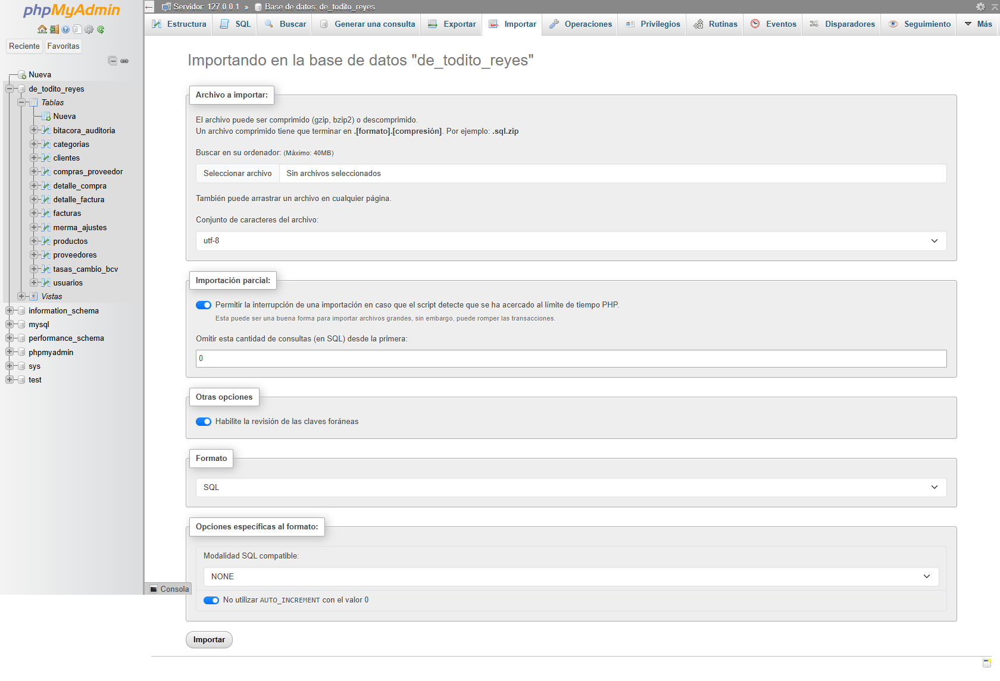
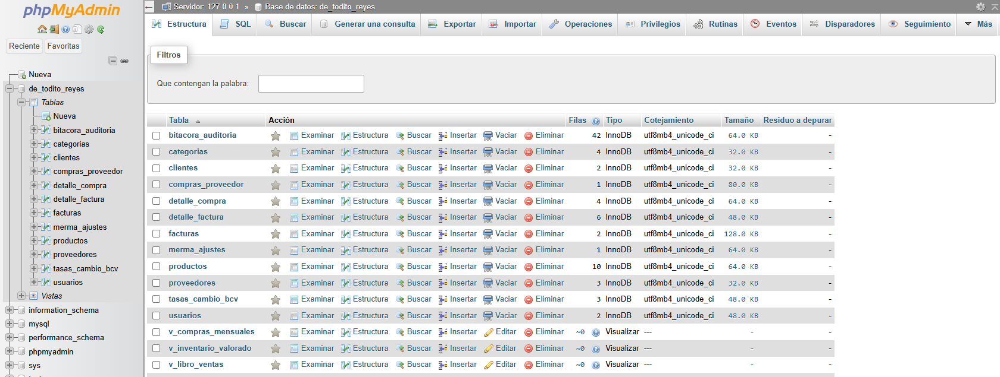
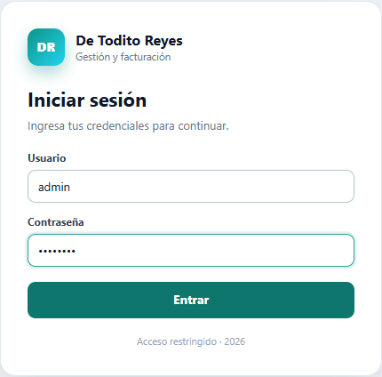
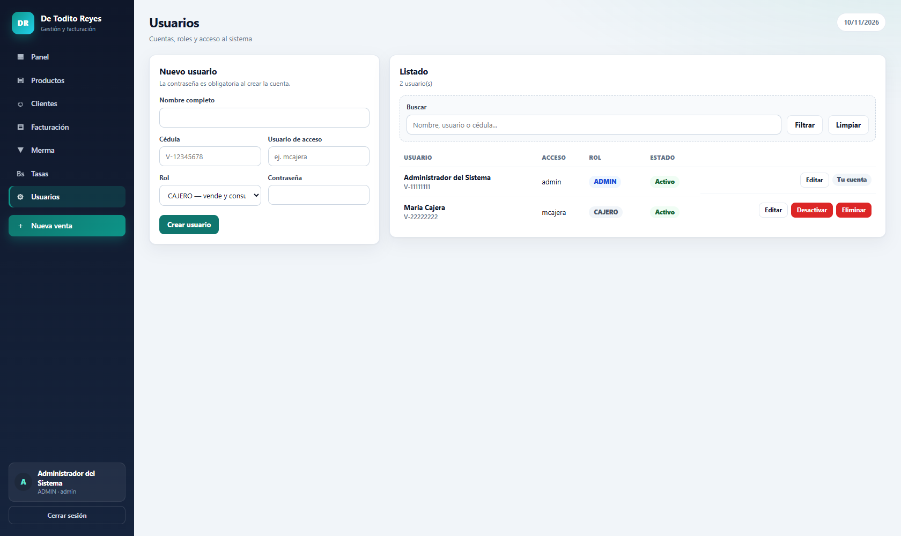
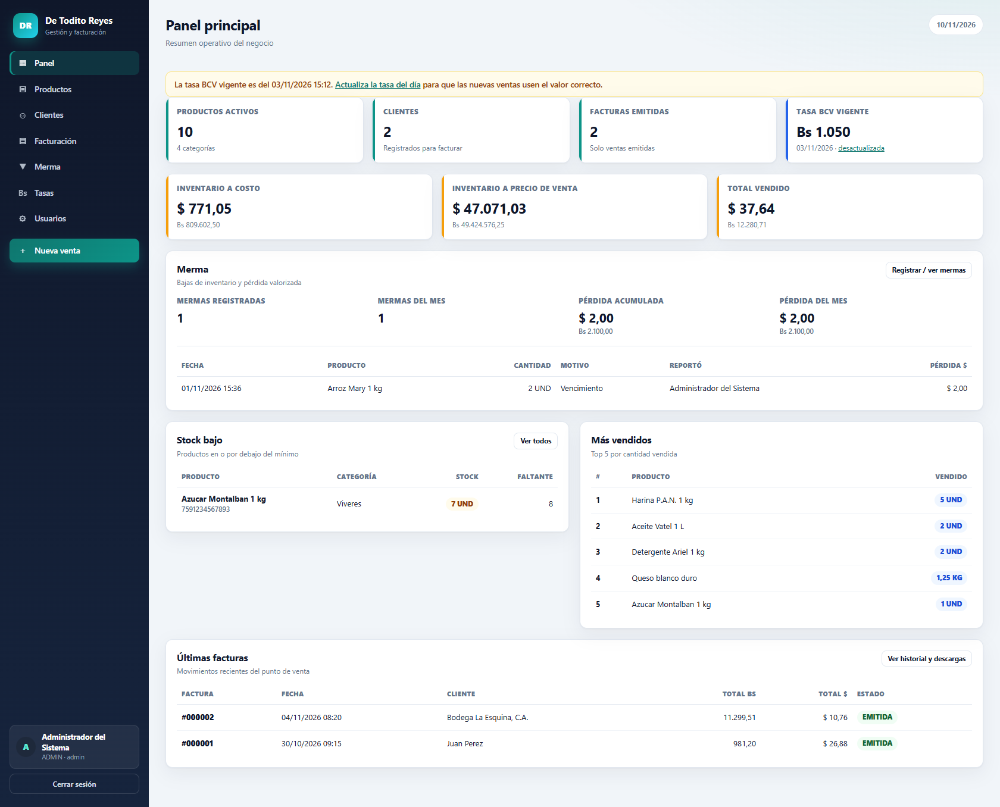
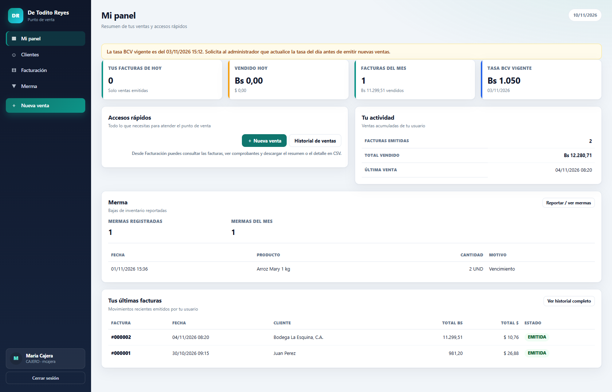
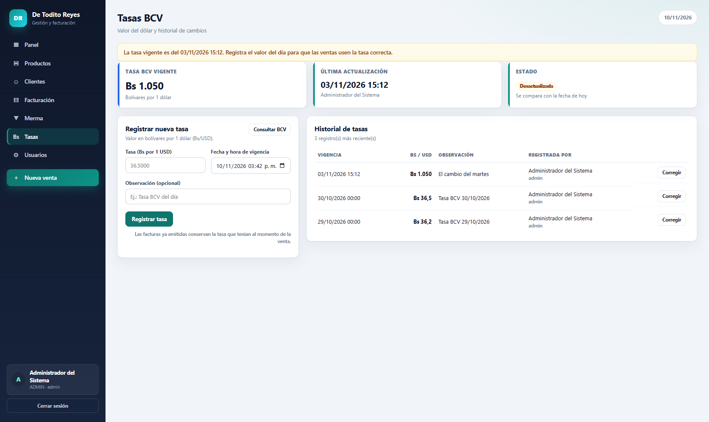

# Manual de instalación — Sistema De Todito Reyes

**Versión del documento:** 1.0  
**Sistema:** De Todito Reyes — Gestión y facturación  
**Entorno de referencia:** Windows 10/11 + XAMPP (Apache 2.4, PHP 8.3, MariaDB 10.4)  
**Fecha:** 6 de noviembre de 2026  
**Documentos relacionados:** [Manual de usuario](MANUAL_USUARIO.md) · [Revisión técnica](REVISION_TECNICA.md) · [Diagramas de casos de uso](casos-de-uso/)

---

## 1. Introducción

Este manual describe cómo instalar, configurar, publicar y mantener el sistema **De Todito Reyes** en un servidor propio. Está dirigido a la persona responsable de la infraestructura (administrador de sistemas) y a quien vaya a desplegar el sistema por primera vez.

El sistema es una aplicación web en **PHP + MySQL** con arquitectura MVC sin framework. La única carpeta que debe quedar publicada es `public/`; el resto (`app/`, `config/`, `sql/`, `tools/`, `docs/`) contiene código interno, credenciales o scripts de recuperación y **no debe ser accesible desde el navegador**.

> **Alcance de este documento.** Las instrucciones se basan en la estructura y el código del proyecto. La revisión técnica asociada se hizo de forma estática y con verificación de sintaxis, sin ejecutar MySQL; por eso la instalación debe probarse en el servidor destino antes de ponerla en producción.

---

## 2. Requisitos

### 2.1 Hardware mínimo

| Recurso | Mínimo | Recomendado |
|---|---|---|
| Procesador | 2 núcleos | 4 núcleos |
| Memoria RAM | 2 GB | 4 GB o más |
| Disco libre | 1 GB | 10 GB (base de datos, copias y comprobantes) |
| Red | LAN local | LAN con IP fija o nombre DNS interno |

Para una sola caja alcanza una computadora modesta. Si varias cajas van a facturar al mismo tiempo, el servidor debe tener disco rápido y una conexión de red estable.

### 2.2 Software

| Componente | Versión mínima | Notas |
|---|---|---|
| PHP | **8.0 o superior** | El código usa `match`, disponible desde PHP 8.0. El README del proyecto dice 7.4, pero esa versión **no** es suficiente. |
| MySQL / MariaDB | MySQL 8.0+ / MariaDB 10.4+ | El esquema usa `CHECK`, vistas y triggers. |
| Apache | 2.4+ con `mod_rewrite` | Necesario para las URLs limpias. XAMPP lo trae activo. |
| Navegador | Chrome, Edge, Firefox o Safari actualizados | No se requiere internet para operar. |

> **Aviso sobre el README.** El README original indica PHP 7.4 y menciona 34 archivos PHP; el proyecto actual tiene 40 archivos y requiere PHP 8.0+. Este manual prevalece sobre el README en esos puntos.

### 2.3 Extensiones de PHP

| Extensión | ¿Obligatoria? | Uso | Estado típico en XAMPP |
|---|---|---|---|
| `pdo_mysql` | Sí | Conexión a la base de datos | Activa |
| `mbstring` | Sí | Texto y codificación | Activa |
| `json` | Sí | Respuestas y datos | Activa (incluida) |
| `fileinfo` | Recomendada | Detección de tipos de archivo | Activa |
| `openssl` | Recomendada | HTTPS y funciones criptográficas | Activa (incluida) |
| `gd` | **Para PNG** | Generar el comprobante en imagen | **Desactivada por defecto** |

Sin `gd`, el sistema sigue funcionando, pero el botón **Descargar imagen** falla. El PDF y la impresión no dependen de GD.

### 2.4 Puertos y permisos

- Apache escucha en el puerto **80** (HTTP) y, si se configura HTTPS, en el **443**.
- MySQL/MariaDB escucha en el **3306**.
- En Windows, el usuario que ejecuta Apache necesita **lectura** sobre el proyecto y **escritura** sobre los registros de Apache y MySQL. La aplicación no escribe archivos en el proyecto: el PDF y el PNG se generan en memoria y se envían al navegador.
- En Linux, el usuario del servidor web (por ejemplo `www-data`) debe poder leer todo el proyecto y ejecutar PHP; `config/` no debe ser escribible por el servidor.

---

## 3. Instalación paso a paso con XAMPP

### 3.1 Instalar XAMPP

1. Descarga XAMPP desde `https://www.apachefriends.org/`.
2. Instala en la ruta por defecto `C:\xampp` (evita rutas con espacios o acentos).
3. Abre el **Panel de Control de XAMPP**.
4. Pulsa **Start** en **Apache** y en **MySQL**. Ambos deben quedar en verde.
5. Si Apache no arranca, revisa el puerto 80 en la sección de solución de problemas.

### 3.2 Copiar el proyecto

Copia la carpeta del sistema en:

```text
C:\xampp\htdocs\revisionSistema
```

La estructura debe quedar así:

```text
C:\xampp\htdocs\revisionSistema\
├── public\      ← única carpeta publicada
├── app\
├── config\
├── sql\
├── tools\
├── docs\
└── README.md
```

Si el proyecto está en otra ruta, ajusta todos los comandos de este manual.

### 3.3 Iniciar los servicios

En el Panel de Control de XAMPP:

1. **Apache → Start**.
2. **MySQL → Start**.

Comprueba que MySQL responde:

```bat
C:\xampp\mysql\bin\mysqladmin.exe -u root ping
```

Respuesta esperada: `mysqld is alive`.

### 3.4 Importar la base de datos

El archivo `sql/de_todito_reyes.sql` crea la base `de_todito_reyes`, las 12 tablas, las 4 vistas, los 4 triggers y los datos de ejemplo.

> **Advertencia importante:** el script empieza con `DROP TABLE IF EXISTS` para las 12 tablas. Si lo ejecutas sobre una base que ya tiene información, **borra todos los datos**. Úsalo solo en una instalación nueva o después de una copia de seguridad verificada.

#### Opción A — phpMyAdmin (recomendada para principiantes)

1. Abre `http://localhost/phpmyadmin/`.
2. Entra con usuario `root` y contraseña vacía (configuración por defecto de XAMPP).
3. Selecciona la pestaña **Importar**.
4. Pulsa **Elegir archivo** y selecciona `C:\xampp\htdocs\revisionSistema\sql\de_todito_reyes.sql`.
5. Verifica que el juego de caracteres sea **utf-8**.
6. Pulsa **Continuar** y espera el mensaje de éxito.
7. En la lista de la izquierda debe aparecer la base `de_todito_reyes` con 12 tablas y 4 vistas.



#### Opción B — consola

```bat
C:\xampp\mysql\bin\mysql.exe -u root --default-character-set=utf8mb4 < "C:\xampp\htdocs\revisionSistema\sql\de_todito_reyes.sql"
```

Verifica la importación:

```bat
C:\xampp\mysql\bin\mysql.exe -u root -e "USE de_todito_reyes; SHOW TABLES;"
```

Deben aparecer, entre otras: `usuarios`, `clientes`, `productos`, `facturas`, `detalle_factura`, `tasas_cambio_bcv`, `merma_ajustes` y `bitacora_auditoria`.



#### Si la base ya existía

No vuelvas a importar el script completo. Aplica solo la migración pendiente (ver sección 7) y trabaja siempre sobre una copia de seguridad.

### 3.5 Configurar la conexión a la base de datos

Edita `config/database.php`:

```php
const DB_HOST    = 'localhost';
const DB_NAME    = 'de_todito_reyes';
const DB_USER    = 'root';
const DB_PASS    = '';
const DB_CHARSET = 'utf8mb4';
```

- En XAMPP, `root` sin contraseña funciona solo en local. **No uses ese usuario en producción.**
- Si MySQL está en otro equipo, cambia `DB_HOST` por su IP o nombre y asegúrate de que acepte conexiones remotas.
- La conexión fija la zona horaria en `-04:00` (Venezuela) para que `NOW()` coincida con la fecha local.

### 3.6 Configurar los datos fiscales de la empresa

Edita `config/empresa.php`:

```php
const EMPRESA_NOMBRE    = 'De Todito Reyes';
const EMPRESA_RIF       = 'J-00000000-0';
const EMPRESA_DIRECCION = 'Dirección fiscal pendiente';
const EMPRESA_TELEFONO  = '';
```

Estos datos aparecen en el comprobante, el PDF y el PNG. Cámbialos por los datos fiscales reales **antes de emitir la primera factura**. No hay pantalla en el sistema para editarlos: se cambian en el archivo.

### 3.7 Activar la extensión GD (para comprobantes PNG)

1. Abre `C:\xampp\php\php.ini` con un editor de texto.
2. Busca la línea:

   ```ini
   ;extension=gd
   ```

3. Quita el punto y coma:

   ```ini
   extension=gd
   ```

4. Guarda el archivo.
5. Reinicia **Apache** desde el Panel de Control de XAMPP.

Verifica que quedó activa:

```bat
C:\xampp\php\php.exe -m | findstr /i gd
```

Debe imprimir `gd`. Si no aparece, revisa que editaste el `php.ini` correcto (`C:\xampp\php\php.ini`) y que reiniciaste Apache.

### 3.8 Verificar extensiones y sintaxis

```bat
C:\xampp\php\php.exe -m
C:\xampp\php\php.exe -v
```

Comprueba que estén `pdo_mysql`, `mbstring`, `json` y, si vas a usar PNG, `gd`.

Para validar la sintaxis de todo el código:

```bat
cd /d "C:\xampp\htdocs\revisionSistema"
for /r app %f in (*.php) do @C:\xampp\php\php.exe -l "%f"
for %f in (public\index.php config\*.php tools\*.php) do @C:\xampp\php\php.exe -l "%f"
```

Cada archivo debe responder `No syntax errors detected`.

---

## 4. Publicar el sistema con Apache

### 4.1 Opción A — subcarpeta de `htdocs`

Con el proyecto en `C:\xampp\htdocs\revisionSistema`, la dirección es:

```text
http://localhost/revisionSistema/public/
```

Esta opción funciona sin tocar la configuración de Apache, siempre que `mod_rewrite` esté activo y `AllowOverride All` esté permitido en `htdocs` (XAMPP lo trae así). Las URLs limpias quedan como:

```text
http://localhost/revisionSistema/public/panel
http://localhost/revisionSistema/public/facturacion/nueva
```

### 4.2 Opción B — dominio propio con VirtualHost (recomendada)

Permite una URL limpia, por ejemplo `http://toditoreyes.local/`.

1. Edita `C:\xampp\apache\conf\extra\httpd-vhosts.conf` y agrega:

   ```apache
   <VirtualHost *:80>
       ServerName toditoreyes.local
       DocumentRoot "C:/xampp/htdocs/revisionSistema/public"

       <Directory "C:/xampp/htdocs/revisionSistema/public">
           Options -Indexes +FollowSymLinks
           AllowOverride All
           Require all granted
       </Directory>

       ErrorLog "logs/toditoreyes-error.log"
       CustomLog "logs/toditoreyes-access.log" combined
   </VirtualHost>
   ```

2. Abre el Bloc de notas **como administrador** y edita:

   ```text
   C:\Windows\System32\drivers\etc\hosts
   ```

   Agrega al final:

   ```text
   127.0.0.1    toditoreyes.local
   ```

3. Reinicia Apache.
4. Abre `http://toditoreyes.local/`.

> **No publiques la carpeta completa del proyecto.** Si `DocumentRoot` apunta a `revisionSistema/` en lugar de `revisionSistema/public/`, el navegador podría alcanzar `config/database.php`, `sql/` o `tools/`. Los `.htaccess` internos niegan el acceso como respaldo, pero la configuración correcta es publicar solo `public/`.

### 4.3 Opción C — servidor embebido de PHP (solo desarrollo)

Útil para probar sin Apache. **No lo uses en producción**: es de un solo hilo y no está endurecido.

```bat
C:\xampp\php\php.exe -S 127.0.0.1:8000 -t "C:\xampp\htdocs\revisionSistema\public" "C:\xampp\htdocs\revisionSistema\public\index.php"
```

Luego abre `http://127.0.0.1:8000/`.

El último argumento es el enrutador. Sin él, las URLs limpias (`/productos`, `/facturacion/nueva`) devuelven 404.

### 4.4 HTTPS (recomendado en producción)

El sistema no fuerza HTTPS por sí mismo. Para publicarlo fuera de la red local:

1. Activa `mod_ssl` y el archivo `httpd-ssl.conf` en `C:\xampp\apache\conf\httpd.conf` (en XAMPP suelen estar incluidos).
2. Genera o instala un certificado válido para el dominio.
3. Configura el VirtualHost en el puerto 443 con `SSLEngine on`, `SSLCertificateFile` y `SSLCertificateKeyFile`.
4. Redirige el puerto 80 al 443.
5. Fuerza que la cookie de sesión viaje solo por HTTPS. La aplicación ya define `HttpOnly` y `SameSite=Lax`, pero no `Secure`; agrégalo en `config/helpers.php`:

   ```php
   session_set_cookie_params([
       'lifetime' => 0,
       'path'     => '/',
       'httponly' => true,
       'secure'   => true,      // solo con HTTPS
       'samesite' => 'Lax',
   ]);
   ```

   Si activas `secure` sin HTTPS, el navegador no enviará la cookie y **no podrás iniciar sesión**.

---

## 5. Estructura publicada y archivos sensibles

| Ruta | ¿Accesible por HTTP? | Contenido |
|---|---|---|
| `public/` | **Sí** | Punto de entrada, assets, `.htaccess` |
| `app/` | No | Controladores, modelos, vistas, generadores PDF/PNG |
| `config/` | No | Conexión, credenciales, helpers, datos de empresa |
| `sql/` | No | Esquema y migraciones |
| `tools/` | No | Script de recuperación de ADMIN |
| `docs/` | No | Documentación (puede publicarse aparte si se desea) |

Cada carpeta interna tiene un `.htaccess` que responde `403`. Aun así, la defensa principal es que el `DocumentRoot` apunte a `public/`.

Comprobación rápida (deben fallar con 403 o 404):

```text
http://localhost/revisionSistema/config/database.php
http://localhost/revisionSistema/sql/de_todito_reyes.sql
http://localhost/revisionSistema/tools/crear_admin.php
```

---

## 6. Primer acceso y puesta en marcha

### 6.1 Credenciales de demostración

| Usuario | Contraseña | Rol |
|---|---|---|
| `admin` | `admin123` | ADMIN |
| `mcajera` | `cajera123` | CAJERO |



### 6.2 Cambiar las credenciales antes de operar

1. Entra como `admin`.
2. Ve a **Usuarios**.
3. Cambia la contraseña de `admin` por una clave larga y única.
4. Cambia o desactiva la cuenta `mcajera` de demostración.
5. Crea una cuenta nominal para cada cajero (no compartas usuarios).
6. Si no vas a usar las cuentas demo, desactívalas.



El sistema exige contraseñas de al menos 8 caracteres para los ADMIN creados por consola. Para el resto, aplica una política interna más estricta (12+ caracteres, sin reutilización).

### 6.3 Verificación posterior a la instalación

| # | Prueba | Resultado esperado |
|---|---|---|
| 1 | Abrir `/` | Muestra el formulario de inicio de sesión |
| 2 | Entrar con `admin` / `admin123` | Llega al panel ADMIN |
| 3 | Abrir `/panel` sin sesión | Redirige al login |
| 4 | Entrar como CAJERO | Ve **Mi panel**, sin Productos, Tasas ni Usuarios |
| 5 | Abrir `/productos` como CAJERO | Redirige a su panel con aviso |
| 6 | Registrar una tasa BCV como ADMIN | Se guarda y aparece como vigente |
| 7 | Emitir una factura de prueba | Descuenta stock y genera consecutivo |
| 8 | Abrir el comprobante | Muestra número, control y código de verificación |
| 9 | Descargar PDF | Archivo válido, sin URL ni rutas del sistema |
| 10 | Descargar PNG | Funciona solo si `gd` está activa |
| 11 | Exportar CSV | Se abre en Excel con acentos y decimales correctos |
| 12 | Cerrar sesión | Vuelve al login y `/panel` ya no es accesible |
| 13 | Abrir `config/database.php` por HTTP | 403 o 404 |
| 14 | Abrir `tools/crear_admin.php` por HTTP | 403 |

Si alguna prueba falla, revisa la sección 11.





---

## 7. Migraciones y actualizaciones

### 7.1 Instalación nueva

Usa `sql/de_todito_reyes.sql`. Ya incluye la columna `codigo_verificacion` y todo el esquema actual.

### 7.2 Base existente anterior al código de verificación

Si la base se creó con una versión anterior y no tiene la columna `codigo_verificacion`, aplica una sola vez:

```bat
C:\xampp\mysql\bin\mysql.exe -u root --default-character-set=utf8mb4 de_todito_reyes < "C:\xampp\htdocs\revisionSistema\sql\actualizacion_codigo_verificacion.sql"
```

La migración:

- agrega `codigo_verificacion` a `facturas`;
- rellena las facturas existentes con un código aleatorio de 8 caracteres;
- deja la columna como `NOT NULL` con índice único.

**Antes de aplicarla, haz una copia de seguridad.** Si la columna ya existe, el `ALTER TABLE` fallará; en ese caso no la ejecutes de nuevo.

### 7.3 Actualizar el código

1. Haz copia de seguridad de la base y de `config/`.
2. Detén Apache o pon el sistema en mantenimiento.
3. Reemplaza `app/`, `public/` y `docs/` por la versión nueva.
4. Conserva tu `config/database.php` y `config/empresa.php` (o vuelve a aplicar tus datos).
5. Revisa si la versión nueva incluye migraciones en `sql/` y applícalas en orden.
6. Ejecuta el lint de PHP (sección 3.8).
7. Reinicia Apache y recorre la lista de verificación de la sección 6.3.

Nunca sobrescribas `config/database.php` con el archivo de ejemplo si ya tiene credenciales reales.

---

## 8. Copias de seguridad y restauración

### 8.1 Copia de la base de datos

```bat
mkdir "C:\respaldos\de_todito_reyes"
C:\xampp\mysql\bin\mysqldump.exe -u root --single-transaction --routines --triggers --default-character-set=utf8mb4 de_todito_reyes > "C:\respaldos\de_todito_reyes\basedatos_2026-11-06.sql"
```

Incluye `--routines` y `--triggers` para no perder la lógica almacenada. El archivo resultante contiene datos y estructura.

### 8.2 Restauración

```bat
C:\xampp\mysql\bin\mysql.exe -u root --default-character-set=utf8mb4 -e "CREATE DATABASE IF NOT EXISTS de_todito_reyes CHARACTER SET utf8mb4 COLLATE utf8mb4_unicode_ci;"
C:\xampp\mysql\bin\mysql.exe -u root --default-character-set=utf8mb4 de_todito_reyes < "C:\respaldos\de_todito_reyes\basedatos_2026-11-06.sql"
```

Si la base ya existe y quieres reemplazarla por completo, elimínala antes de restaurar. Hazlo solo con una copia verificada.

### 8.3 Copia de los archivos

Respalda al menos:

- `config/database.php` y `config/empresa.php` (contienen la configuración local);
- `app/` y `public/` de la versión desplegada;
- los archivos `.sql` de `sql/`;
- los registros de Apache (`C:\xampp\apache\logs\`) si se usan para auditoría.

La aplicación no guarda PDF ni PNG en disco: se generan al vuelo. No hay una carpeta `uploads/` que respaldar.

### 8.4 Frecuencia y retención sugeridas

| Tipo | Frecuencia | Retención |
|---|---|---|
| Base de datos completa | Diaria, al cierre | 30 días |
| Base de datos completa | Semanal, fuera del servidor | 12 semanas |
| Configuración y código | En cada cambio | Últimas 5 versiones |
| Copia externa | Mensual | 12 meses |

Guarda al menos una copia **fuera del mismo equipo**. Una copia en el mismo disco no protege contra fallos de hardware ni ransomware.

### 8.5 Prueba de restauración

Una copia no sirve si no se puede restaurar. Cada trimestre:

1. Restaura la copia en una base de prueba (`de_todito_reyes_prueba`).
2. Verifica que las facturas, el stock y los usuarios estén completos.
3. Abre el sistema apuntando a la base de prueba.
4. Elimina la base de prueba al terminar.

---

## 9. Seguridad y endurecimiento

### 9.1 Usuario de base de datos dedicado

No uses `root` en producción. Crea un usuario con permisos mínimos:

```sql
CREATE USER 'todito_reyes'@'localhost' IDENTIFIED BY 'UnaClaveLargaYUnica';
GRANT SELECT, INSERT, UPDATE, DELETE ON de_todito_reyes.* TO 'todito_reyes'@'localhost';
FLUSH PRIVILEGES;
```

Luego actualiza `config/database.php` con ese usuario y contraseña. La aplicación no crea ni altera tablas en tiempo de ejecución, así que no necesita `CREATE`, `ALTER` ni `DROP`. Para aplicar migraciones usa una cuenta administrativa aparte.

Si el servidor web y MySQL están en equipos distintos, cambia `'localhost'` por la IP del servidor web y restringe el acceso por firewall.

### 9.2 Contraseñas y cuentas

- Cambia `admin123` y `cajera123` antes del primer uso real.
- Una cuenta por persona; no compartas el usuario `admin`.
- Desactiva las cuentas que ya no se usen; no las dejes activas “por si acaso”.
- El sistema impide desactivar la propia cuenta y dejar la instalación sin ningún ADMIN activo.
- La sesión caduca a los 30 minutos de inactividad.
- No hay recuperación de contraseña por correo. Si se pierde el acceso ADMIN, usa `tools/crear_admin.php` desde la consola del servidor.

### 9.3 Proteger el script de recuperación

`tools/crear_admin.php` solo se ejecuta por CLI y responde `403` por HTTP. Aun así:

- No publiques `tools/` en internet.
- Si el sistema queda accesible desde fuera, elimina o mueve el script cuando termines la recuperación.
- Restringe el acceso al servidor por SSH/RDP y usa cuentas nominales.

### 9.4 HTTPS y cookies

- Publica el sistema con HTTPS si sale de la red local.
- Activa `secure` en la cookie de sesión cuando HTTPS esté funcionando (sección 4.4).
- No desactives `HttpOnly` ni `SameSite`.
- El sistema ya envía `Content-Security-Policy`, `X-Frame-Options: DENY`, `X-Content-Type-Options: nosniff` y `Referrer-Policy: same-origin`.

### 9.5 phpMyAdmin

phpMyAdmin viene con XAMPP y es una puerta sensible:

- No lo publiques en internet.
- Si no lo usas, deshabilítalo o restringe el acceso por IP en `C:\xampp\apache\conf\extra\httpd-xampp.conf`.
- Cámbiale la contraseña al usuario `root` o crea un usuario administrador propio.
- Cierra la sesión de phpMyAdmin al terminar.

### 9.6 Permisos de archivos

**Windows:** mantén el proyecto en una ruta local (no en una carpeta compartida de red) y da lectura al usuario que ejecuta Apache. No des permisos de escritura sobre `config/`.

**Linux:**

```bash
sudo chown -R www-data:www-data /var/www/revisionSistema
sudo find /var/www/revisionSistema -type d -exec chmod 755 {} \;
sudo find /var/www/revisionSistema -type f -exec chmod 644 {} \;
sudo chmod 640 /var/www/revisionSistema/config/database.php
```

El `DocumentRoot` debe ser `/var/www/revisionSistema/public`.

### 9.7 Errores y registros

- En producción, `display_errors` debe estar **Off** y `log_errors` **On** en `php.ini`.
- Los errores técnicos se registran en el log de PHP/Apache y el usuario ve un mensaje genérico.
- Revisa periódicamente `C:\xampp\apache\logs\error.log` y el log de PHP.
- No publiques los logs en una carpeta accesible por HTTP.

Configuración recomendada en producción:

```ini
display_errors = Off
log_errors = On
error_log = "C:\xampp\apache\logs\php-error.log"
expose_php = Off
session.cookie_httponly = 1
session.use_strict_mode = 1
```

### 9.8 Red y firewall

- Si el sistema es solo para la tienda, no lo expongas a internet.
- Permite el puerto 80/443 solo desde la red local.
- No abras el puerto 3306 a internet.
- Usa una IP fija o un nombre DNS interno para el servidor.
- Si necesitas acceso remoto, usa una VPN en lugar de publicar Apache directamente.

### 9.9 Actualizaciones

- Mantén XAMPP, PHP y MySQL actualizados, probando primero en un entorno de staging.
- Revisa los avisos de seguridad de PHP y MariaDB/MySQL.
- Después de cada actualización, repite la lista de verificación de la sección 6.3.

---

## 10. Operación y mantenimiento

### 10.1 Tasa BCV

La tasa **no se descarga automáticamente**. Un ADMIN debe consultar el valor oficial en `https://www.bcv.org.ve/` y registrarlo en **Tasas** con su fecha de vigencia. Si la tasa es de un día anterior, el sistema muestra un aviso en el panel, el POS y el historial.



Cada factura guarda la tasa aplicada. Corregir una tasa histórica no cambia las facturas ya emitidas.

### 10.2 Stock y mermas

- El stock se descuenta al emitir una factura y al registrar una merma.
- La anulación de una factura devuelve las cantidades al stock.
- Revisa el aviso de **stock bajo** en el panel ADMIN.
- Registra las mermas con el motivo correcto para mantener la trazabilidad.

### 10.3 Espacio en disco

La base crece con las facturas, el detalle y la bitácora. Revisa el espacio libre mensualmente. Los PDF y PNG no se almacenan, pero las copias de seguridad sí ocupan disco.

### 10.4 Bitácora de auditoría

La tabla `bitacora_auditoria` registra eventos como `LOGIN`, `LOGIN_FALLIDO`, `LOGOUT`, `CREAR_ADMIN`, `RESET_ADMIN`, cambios de facturas y movimientos relevantes. No la borres: es la evidencia de auditoría. Si necesitas depurarla, archiva los registros antiguos antes de eliminarlos.

### 10.5 Rutina diaria sugerida

1. Verificar que Apache y MySQL estén activos.
2. Revisar que la tasa BCV del día esté registrada.
3. Revisar el panel: stock bajo, ventas del día y últimas facturas.
4. Al cierre, generar la copia de seguridad de la base.
5. Revisar el log de errores si hubo incidentes.

---

## 11. Solución de problemas

### 11.1 “No se pudo conectar con la base de datos”

Causas habituales:

| Causa | Solución |
|---|---|
| MySQL está detenido | Inícialo desde el Panel de XAMPP |
| Nombre de base incorrecto | Debe ser `de_todito_reyes` |
| Usuario o contraseña incorrectos | Revisa `config/database.php` |
| El script SQL no se importó | Importa `sql/de_todito_reyes.sql` |
| MySQL en otro equipo | Verifica `DB_HOST`, el firewall y que MySQL escuche en red |

Comprueba la conexión:

```bat
C:\xampp\mysql\bin\mysql.exe -u root -e "SHOW DATABASES;"
```

### 11.2 Error 2002 (MySQL no responde)

```text
ERROR 2002 (HY000): Can't connect to MySQL server ... (10061)
```

Significa que MySQL no está escuchando. Inícialo en XAMPP y revisa el puerto 3306. Si otro programa lo ocupa, cambia el puerto en `my.ini` y en `config/database.php` (agregando `port=3307` al DSN).

### 11.3 Error 1045 (acceso denegado)

```text
ERROR 1045 (28000): Access denied for user 'root'@'localhost'
```

La contraseña de MySQL no coincide con `DB_PASS`. Si cambiaste la clave de `root`, actualízala en `config/database.php` o crea el usuario dedicado de la sección 9.1.

### 11.4 Error 1049 (base desconocida)

La base `de_todito_reyes` no existe. Importa el script SQL completo o créala y vuelve a importar.

### 11.5 Las URLs limpias dan 404

- Confirma que `mod_rewrite` esté activo en `httpd.conf` (`LoadModule rewrite_module modules/mod_rewrite.so`).
- Confirma que el `DocumentRoot` apunte a `public/`.
- Confirma que `AllowOverride All` esté permitido para esa carpeta.
- Si usas el servidor embebido de PHP, no olvides el argumento del enrutador (`public/index.php`).

### 11.6 Apache no arranca o el puerto 80 está ocupado

- Otro programa (IIS, Skype, un servidor de desarrollo) puede estar usando el puerto 80.
- Cambia el puerto de Apache en `httpd.conf` (`Listen 8080`) y accede por `http://localhost:8080/`.
- Revisa `C:\xampp\apache\logs\error.log` para ver el motivo exacto.

### 11.7 Error 403 al abrir una carpeta interna

Es el comportamiento esperado: `config/`, `app/`, `sql/` y `tools/` niegan el acceso. Si ves 403 al abrir el sistema, revisa que estés entrando por `public/` y no por la raíz del proyecto.

### 11.8 Error 500 o página en blanco

1. Revisa `C:\xampp\apache\logs\error.log`.
2. Activa temporalmente `display_errors` en un entorno de prueba (nunca en producción).
3. Ejecuta el lint de PHP (sección 3.8).
4. Verifica que PHP sea 8.0 o superior.
5. Comprueba que las extensiones `pdo_mysql` y `mbstring` estén activas.

### 11.9 “Descargar imagen” falla

Falta la extensión GD. Sigue la sección 3.7, guarda `php.ini` y reinicia Apache. Verifica con `php -m | findstr /i gd`.

### 11.10 Error 419 “La sesión expiró o la solicitud no es válida”

El token CSRF no coincide o la sesión caducó. Recarga la página, vuelve a iniciar sesión y repite la acción. No envíes formularios con la pestaña abierta durante horas.

### 11.11 Los acentos se ven mal

- La base debe usar `utf8mb4`.
- El archivo SQL debe importarse con `--default-character-set=utf8mb4` o con “utf-8” seleccionado en phpMyAdmin.
- No edites los archivos PHP con un editor que guarde en ANSI/Windows-1252; usa UTF-8 sin BOM.
- Verifica que Apache envíe `charset=utf-8` (el sistema declara la codificación en el HTML).

### 11.12 La hora no coincide con Venezuela

La conexión fija `-04:00` y PHP usa `America/Caracas`. Si la hora del servidor está mal, corrígela en Windows (`Configuración → Hora e idioma`) o en Linux (`timedatectl`). La aplicación no puede corregir un reloj desajustado del sistema operativo.

### 11.13 No puedo entrar como ADMIN

1. Verifica que el usuario esté activo en la base.
2. Usa el script de consola:

   ```bat
   cd /d "C:\xampp\htdocs\revisionSistema"
   C:\xampp\php\php.exe tools\crear_admin.php --listar
   C:\xampp\php\php.exe tools\crear_admin.php --resetear --usuario=admin --clave=NuevaClave123 --si
   ```

3. Si el script dice que no hay conexión, revisa MySQL y `config/database.php`.
4. Si el sistema está en producción, elimina o protege el script después de usarlo.

### 11.14 El PDF se descarga vacío o da error

- Verifica que la factura exista y que el ID sea numérico.
- Revisa el log de PHP: un error de memoria o de codificación puede romper la generación.
- El PDF se genera en el servidor; no depende de Chrome ni de librerías externas.
- Si el problema persiste, compara con una factura de una sola línea para descartar un caso extremo.

### 11.15 El CSV se abre mal en Excel

El sistema exporta UTF-8 con BOM, separador `;` y decimales con coma. Si Excel abre todo en una columna, revisa la configuración regional de Windows (separador de listas). No cambies el archivo a mano antes de abrirlo.

---

## 12. Desinstalación

1. Genera una copia de seguridad si necesitas conservar los datos.
2. Detén Apache y MySQL.
3. Elimina la carpeta `C:\xampp\htdocs\revisionSistema`.
4. Elimina la base de datos:

   ```bat
   C:\xampp\mysql\bin\mysql.exe -u root -e "DROP DATABASE IF EXISTS de_todito_reyes;"
   ```

5. Si creaste un VirtualHost, elimina el bloque de `httpd-vhosts.conf` y la línea de `hosts`.
6. Reinicia Apache.
7. Borra las copias de seguridad solo cuando ya no las necesites y según tu política de retención.

> El `DROP DATABASE` es irreversible. Confirma dos veces que estás en el servidor correcto.

---

## 13. Anexos

### A. Comandos útiles

```bat
:: Versión de PHP y extensiones
C:\xampp\php\php.exe -v
C:\xampp\php\php.exe -m

:: Estado de MySQL
C:\xampp\mysql\bin\mysqladmin.exe -u root ping

:: Importar base nueva (borra datos existentes)
C:\xampp\mysql\bin\mysql.exe -u root --default-character-set=utf8mb4 < "C:\xampp\htdocs\revisionSistema\sql\de_todito_reyes.sql"

:: Copia de seguridad
C:\xampp\mysql\bin\mysqldump.exe -u root --single-transaction --routines --triggers --default-character-set=utf8mb4 de_todito_reyes > "C:\respaldos\de_todito_reyes\basedatos.sql"

:: Restaurar
C:\xampp\mysql\bin\mysql.exe -u root --default-character-set=utf8mb4 de_todito_reyes < "C:\respaldos\de_todito_reyes\basedatos.sql"

:: Servidor embebido de desarrollo
C:\xampp\php\php.exe -S 127.0.0.1:8000 -t "C:\xampp\htdocs\revisionSistema\public" "C:\xampp\htdocs\revisionSistema\public\index.php"

:: Recuperación de ADMIN
cd /d "C:\xampp\htdocs\revisionSistema"
C:\xampp\php\php.exe tools\crear_admin.php --listar
C:\xampp\php\php.exe tools\crear_admin.php --crear --cedula=V-99999999 --nombre="Admin Respaldo" --usuario=admin2 --clave=ClaveSegura123 --si
C:\xampp\php\php.exe tools\crear_admin.php --resetear --usuario=admin --clave=NuevaClave123 --si
```

### B. Lista de verificación de producción

Antes de declarar el sistema en producción, confirma cada punto:

- [ ] PHP 8.0+ con `pdo_mysql`, `mbstring`, `json` y `gd` activas.
- [ ] MySQL/MariaDB activo y base `de_todito_reyes` importada.
- [ ] `config/database.php` con un usuario dedicado, no `root`.
- [ ] `config/empresa.php` con nombre, RIF, dirección y teléfono reales.
- [ ] `DocumentRoot` apuntando a `public/`.
- [ ] `mod_rewrite` activo y `AllowOverride All` en la carpeta publicada.
- [ ] HTTPS configurado (si el sistema sale de la red local).
- [ ] Cookie de sesión con `Secure` cuando HTTPS esté activo.
- [ ] Contraseñas demo cambiadas y cuentas innecesarias desactivadas.
- [ ] `tools/crear_admin.php` protegido o eliminado.
- [ ] phpMyAdmin restringido o deshabilitado.
- [ ] `display_errors = Off` y `log_errors = On`.
- [ ] Copia de seguridad automática configurada y **probada**.
- [ ] Lista de verificación de la sección 6.3 completada.
- [ ] Responsable de soporte y procedimiento de escalamiento definidos.

### C. Valores por defecto que debes cambiar

| Elemento | Valor por defecto | Acción |
|---|---|---|
| Usuario MySQL | `root` sin contraseña | Crear usuario dedicado |
| Contraseña `admin` | `admin123` | Cambiar |
| Contraseña `mcajera` | `cajera123` | Cambiar o desactivar |
| RIF de la empresa | `J-00000000-0` | Reemplazar por el real |
| Dirección fiscal | `Dirección fiscal pendiente` | Reemplazar por la real |
| Teléfono | Vacío | Completar |
| Extensión GD | Desactivada | Activar para PNG |
| HTTPS | No configurado | Configurar en producción |

### D. Contacto y soporte

Este manual no define un canal de soporte corporativo. Antes de entregar el sistema, registra:

- nombre y contacto del responsable técnico;
- horario de atención;
- procedimiento para reportar incidentes;
- ubicación de las copias de seguridad;
- persona autorizada para restablecer contraseñas ADMIN.

---

*Documento elaborado a partir del código, el esquema SQL y la configuración del proyecto. Las rutas y versiones corresponden al entorno de referencia indicado al inicio; ajústalas si tu instalación es distinta.*
