# Manual de usuario — Sistema De Todito Reyes

**Versión del documento:** 1.0  
**Sistema:** De Todito Reyes — Gestión y facturación  
**Roles:** ADMIN (administrador) y CAJERO  
**Fecha:** 6 de noviembre de 2026  
**Documentos relacionados:** [Manual de instalación](MANUAL_INSTALACION.md) · [Revisión técnica](REVISION_TECNICA.md) · [Diagramas de casos de uso](casos-de-uso/)

---

## 1. Introducción

De Todito Reyes es un sistema para administrar clientes, productos, inventario, mermas, tasas de cambio del BCV y facturación en bolívares con IVA e IGTF. Está pensado para un negocio pequeño con dos perfiles:

- **ADMIN:** control total del negocio, inventario, precios, usuarios, tasas y facturas.
- **CAJERO:** opera el punto de venta, registra clientes y consulta la información necesaria para vender.

El sistema funciona en un navegador web. No requiere instalar programas en la computadora del cajero; solo necesita la dirección del servidor y un usuario activo.

> **Importante:** el sistema no envía correos ni mensajes automáticos. La tasa BCV se registra manualmente y las contraseñas se cambian desde el módulo **Usuarios** o, si nadie puede entrar, con el script de consola descrito en el manual de instalación.

---

## 2. Requisitos para usar el sistema

- Un navegador actualizado: Chrome, Edge, Firefox o Safari.
- Conexión a la red donde está instalado el servidor.
- Usuario y contraseña activos.
- Resolución mínima recomendada: 1366 × 768. En pantallas pequeñas el menú lateral se puede abrir con el botón **☰**.

No se necesita conexión a internet para operar, salvo que se quiera consultar el valor oficial en `bcv.org.ve` desde el enlace del módulo **Tasas**.

---

## 3. Acceso al sistema

### 3.1 Dirección

La dirección depende de cómo se instaló:

| Instalación | Dirección típica |
|---|---|
| Apache con el proyecto en `htdocs` | `http://localhost/revisionSistema/public/` |
| Apache con `DocumentRoot` en `public/` | `http://localhost/` |
| Servidor embebido de PHP | `http://127.0.0.1:8000/` |

La raíz `/` siempre muestra el inicio de sesión. El panel está en `/panel` y no se puede abrir sin sesión activa.

### 3.2 Iniciar sesión

1. Abre la dirección del sistema.
2. Escribe tu **Usuario**.
3. Escribe tu **Contraseña**.
4. Pulsa **Entrar**.

Si los datos son correctos, el sistema te lleva al panel que corresponde a tu rol.

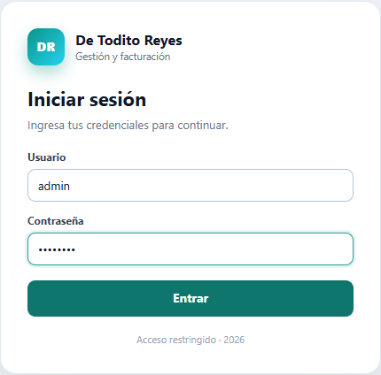

### 3.3 Credenciales de demostración

| Usuario | Contraseña | Rol |
|---|---|---|
| `admin` | `admin123` | ADMIN |
| `mcajera` | `cajera123` | CAJERO |

> **Cambia estas contraseñas antes de usar el sistema en producción.** Si las cuentas demo no se van a usar, desactívalas desde **Usuarios**.

### 3.4 Si olvidaste la contraseña

- Si eres **CAJERO**, pide al ADMIN que restablezca tu contraseña desde **Usuarios**.
- Si eres **ADMIN** y no puedes entrar, usa el script de consola `tools/crear_admin.php` (ver manual de instalación). Ese script no funciona desde el navegador.

### 3.5 Cerrar sesión

Pulsa **Cerrar sesión** al final del menú lateral. El cierre se hace por `POST` con protección CSRF; no existe un enlace `GET /logout` que cierre la sesión.

La sesión se cierra automáticamente después de **30 minutos de inactividad**. Si tu cuenta es desactivada o eliminada mientras estás conectado, la siguiente petición te llevará al login con un aviso.

### 3.6 Comportamiento del navegador

- Las páginas autenticadas no se guardan en caché. El botón **Atrás** no debe mostrar el panel después de cerrar sesión.
- Si abres `/` con una sesión abierta, el sistema cierra esa sesión y te pide la contraseña de nuevo. Es intencional.
- Si ves un error **419**, la sesión expiró o el formulario perdió el token de seguridad. Recarga la página e inténtalo de nuevo.

---

## 4. Roles y permisos

### 4.1 Tabla de permisos

| Acción | ADMIN | CAJERO |
|---|:---:|:---:|
| Iniciar y cerrar sesión | ✔ | ✔ |
| Ver el panel administrativo | ✔ | ✘ |
| Ver el panel personal de ventas | ✔ | ✔ |
| Consultar clientes | ✔ | ✔ |
| Registrar clientes nuevos | ✔ | ✔ |
| Editar o eliminar clientes | ✔ | ✘ |
| Consultar productos e inventario | ✔ | ✘ |
| Crear, editar, activar/desactivar o eliminar productos | ✔ | ✘ |
| Emitir facturas en el POS | ✔ | ✔ |
| Consultar historial de ventas y comprobantes | ✔ | ✔ |
| Descargar PDF, PNG o imprimir | ✔ | ✔ |
| Exportar resumen o detalle CSV | ✔ | ✔ |
| Consultar la tasa BCV y su historial | ✔ | ✔ |
| Registrar o corregir la tasa BCV | ✔ | ✘ |
| Anular facturas | ✔ | ✘ |
| Eliminar facturas anuladas | ✔ | ✘ |
| Registrar mermas | ✔ | ✔ |
| Consultar mermas | ✔ | ✔ |
| Ver costos y pérdidas por merma | ✔ | ✘ |
| Gestionar usuarios | ✔ | ✘ |

### 4.2 Menú según el rol

**ADMIN:**

- Panel
- Productos
- Clientes
- Facturación
- Merma
- Tasas
- Usuarios
- Nueva venta

**CAJERO:**

- Mi panel
- Clientes
- Facturación
- Merma
- Nueva venta

El CAJERO no ve **Productos**, **Tasas** ni **Usuarios**. Si intenta abrir `/productos` o `/usuarios` escribiendo la dirección, el servidor lo redirige a su panel con un aviso. Las restricciones no dependen de ocultar botones: se validan en el servidor.

---

## 5. Panel principal

### 5.1 Panel del ADMIN

Al entrar como ADMIN, el panel muestra:

| Tarjeta o sección | Qué significa |
|---|---|
| Productos activos | Cantidad de productos con `activo = 1` y número de categorías. |
| Clientes | Total de clientes registrados. |
| Facturas emitidas | Total de facturas en estado `EMITIDA` y cantidad de mermas. |
| Tasa BCV vigente | Valor del dólar y fecha de vigencia. Si está desactualizada, aparece un enlace a **Tasas**. |
| Inventario a costo | Valor del stock actual multiplicado por el costo en USD. |
| Inventario a precio de venta | Valor del stock actual multiplicado por el precio de venta en USD. |
| Total vendido | Suma de facturas emitidas en USD y Bs. |
| Stock bajo | Productos en o por debajo del stock mínimo, con el faltante. |
| Más vendidos | Top 5 de productos por cantidad vendida. |
| Últimas facturas | Movimientos recientes con enlace al comprobante. |
| Pérdidas por merma | Aparece si hay pérdidas acumuladas. |

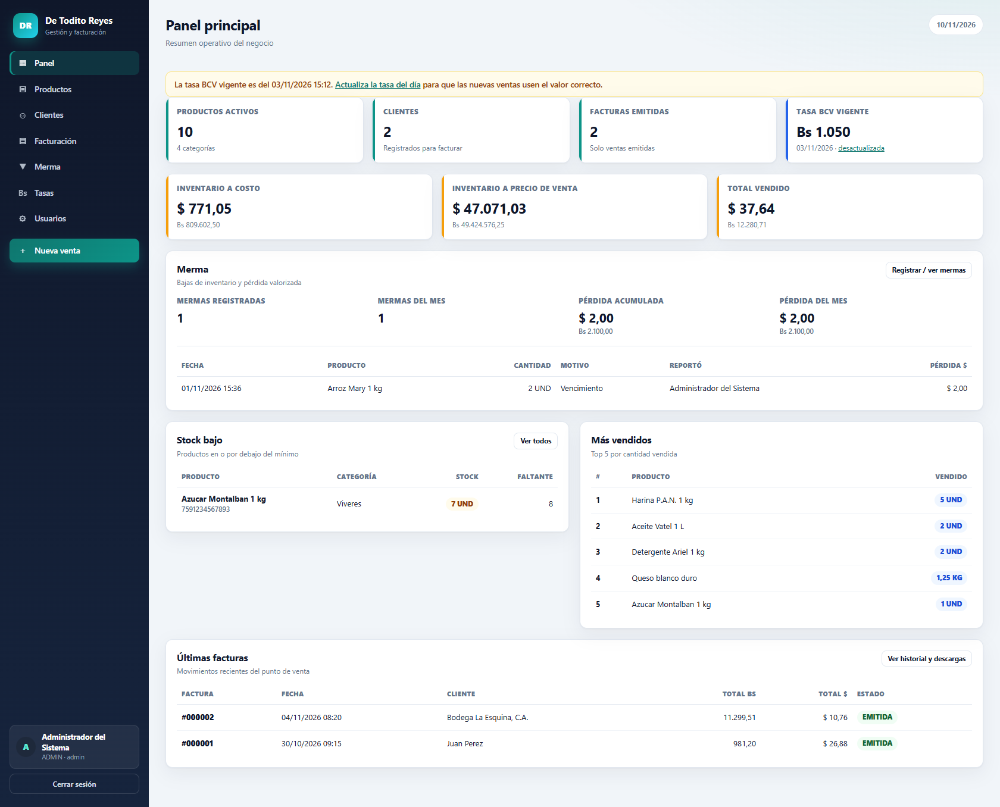

### 5.2 Panel del CAJERO (“Mi panel”)

El CAJERO ve solo su actividad:

- **Tus facturas de hoy:** cantidad de facturas emitidas hoy por su usuario.
- **Vendido hoy:** total en Bs y USD de sus ventas de hoy.
- **Facturas del mes:** cantidad y total vendido en el mes.
- **Tasa BCV vigente:** valor y fecha; si está desactualizada, aviso para pedir al ADMIN.
- **Accesos rápidos:** botones **Nueva venta** e **Historial de ventas**.
- **Tu actividad:** facturas emitidas, total vendido y última venta.
- **Tus últimas facturas:** movimientos recientes emitidos por su usuario.

El panel del CAJERO **no** muestra inventario, costos, pérdidas, productos ni datos de otros usuarios.

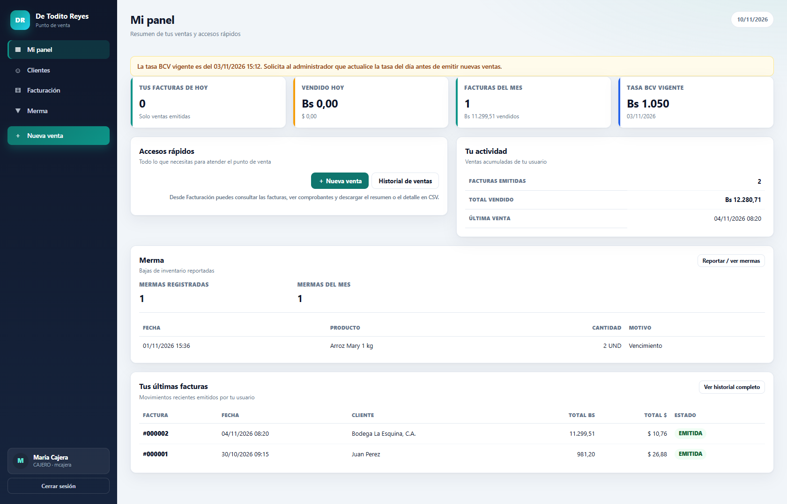

---

## 6. Clientes

Ruta: **Clientes** (`/clientes`).

### 6.1 Consultar

1. Entra a **Clientes**.
2. Usa el campo **Buscar** por nombre, cédula o RIF.
3. Pulsa **Filtrar**.
4. Pulsa **Limpiar** para ver todos.

La tabla muestra cliente, RIF/cédula, teléfono, dirección y cantidad de facturas.

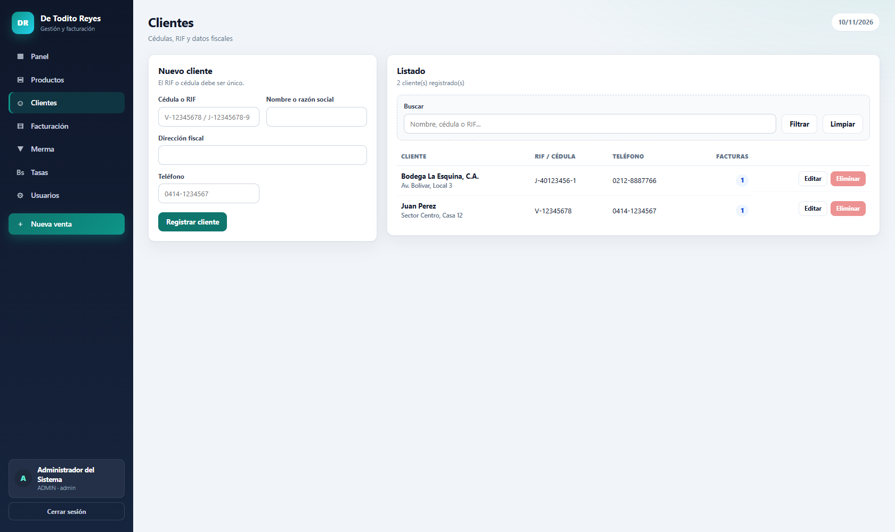

### 6.2 Registrar un cliente

Pueden hacerlo ADMIN y CAJERO.

1. En **Nuevo cliente**, completa:
   - **Cédula o RIF:** obligatorio. Formato `V-12345678` o `J-12345678-9`. Letras permitidas: `V`, `E`, `J`, `G`, `P`; guion; entre 6 y 9 dígitos; opcional un dígito final.
   - **Nombre o razón social:** obligatorio, máximo 120 caracteres.
   - **Dirección fiscal:** opcional, máximo 180 caracteres.
   - **Teléfono:** opcional, máximo 25 caracteres.
2. Pulsa **Registrar cliente**.
3. Si el RIF/cédula ya existe, el sistema muestra “Ya existe otro cliente con esa cédula o RIF.”

### 6.3 Editar o eliminar

Solo el ADMIN ve los botones **Editar** y **Eliminar**.

- **Editar:** abre el formulario con los datos actuales; pulsa **Guardar cambios**.
- **Eliminar:** solo se permite si el cliente **no tiene facturas**. Si tiene, el botón aparece deshabilitado y el servidor también rechaza el borrado. En ese caso, edita los datos en lugar de borrar.

El CAJERO puede consultar y crear clientes, pero no editar ni eliminar. Si lo intenta por URL o por un POST manipulado, el servidor responde con “Solo un administrador puede editar o eliminar clientes.”

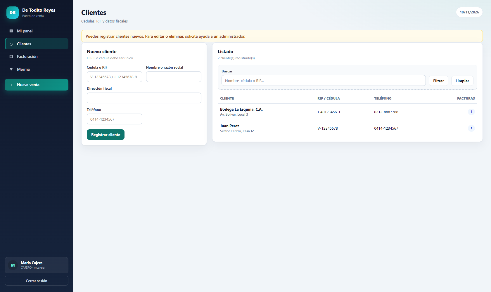

---

## 7. Productos e inventario (solo ADMIN)

Ruta: **Productos** (`/productos`).

### 7.1 Conceptos importantes

- **Costo en USD:** lo que cuesta adquirir el producto.
- **Precio de venta en USD:** lo que se cobra al cliente.
- **Costo/Precio en Bs (BCV):** campo de referencia calculado con la tasa vigente. No se guarda en la base; el POS aplica la tasa del momento de la venta.
- **Alícuota IVA:** porcentaje de IVA del producto. Valores habituales: `0` (exento), `8` (reducida) y `16` (general). Se permiten valores entre 0 y 100.
- **Stock actual / mínimo / máximo:** cantidades en la unidad de medida. El stock máximo es opcional.

### 7.2 Crear un producto

1. Entra a **Productos**.
2. En **Nuevo producto**, completa:
   - **Nombre del producto:** obligatorio, máximo 120 caracteres.
   - **Código de barras / QR:** obligatorio, máximo 64 caracteres y único.
   - **Categoría:** obligatoria.
   - **Unidad de medida:** Unidad (`UND`), Kilogramo (`KG`), Litro (`LT`), Gramo (`GR`) o Paquete (`PAQ`).
   - **Alícuota IVA (%):** 0, 8 o 16, o el valor que corresponda.
   - **Costo en USD:** mayor o igual a 0.
   - **Precio de venta en USD:** mayor o igual a 0.
   - **Stock actual**, **Stock mínimo** y, si aplica, **Stock máximo:** mayores o iguales a 0.
3. Pulsa **Crear producto**.

Si no hay tasa BCV registrada, el sistema avisa que no puede calcular los equivalentes en Bs. Puedes guardar el producto igualmente; el cálculo en Bs se actualizará cuando exista una tasa.

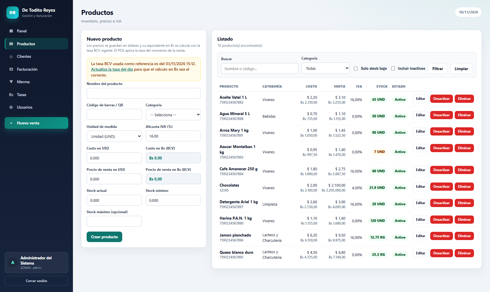

### 7.3 Editar, activar y desactivar

- **Editar:** abre el formulario con los datos actuales. Pulsa **Guardar cambios**.
- **Desactivar:** el producto deja de aparecer en el POS y en los listados por defecto, pero conserva su historial. Pulsa **Reactivar** para volver a usarlo.
- **Eliminar:** solo se permite si el producto **no tiene ventas, compras ni mermas**. Si tiene historial, el sistema lo rechaza y sugiere desactivarlo.

### 7.4 Buscar y filtrar

- **Buscar:** por nombre o código.
- **Categoría:** filtra por categoría.
- **Solo stock bajo:** muestra productos con `stock_actual <= stock_minimo`.
- **Incluir inactivos:** muestra también los desactivados.
- **Limpiar:** quita todos los filtros.

La tabla muestra costo y precio en USD con su equivalente en Bs, IVA, stock con color (verde/amarillo/rojo) y estado.

### 7.5 Buenas prácticas de inventario

- Usa códigos únicos y legibles.
- Revisa el **Stock bajo** del panel antes de abrir caja.
- No cambies el stock actual para “cuadrar” ventas: usa **Merma** para bajas justificadas.
- Desactiva en lugar de eliminar cuando el producto ya tenga historial.

---

## 8. Punto de venta (POS)

Ruta: **Nueva venta** (`/facturacion/nueva`). Disponible para ADMIN y CAJERO.

### 8.1 Antes de vender

Verifica:

1. Que exista una **tasa BCV** registrada. Sin tasa, el servidor no permite emitir.
2. Que la tasa sea del día. Si está desactualizada, el sistema muestra un aviso; puedes vender, pero los totales usarán esa tasa.
3. Que haya **clientes** registrados. Si no hay, el POS muestra un enlace para crear uno.
4. Que haya **productos activos** con stock. Si no hay, muestra un enlace a Productos (solo ADMIN) o pide al ADMIN.

### 8.2 Pasos para emitir una factura

1. Entra a **Nueva venta**.
2. En el catálogo, busca el producto por nombre o código y pulsa **Agregar**.
   - También puedes usar el buscador del catálogo.
   - Los productos sin stock tienen el botón deshabilitado.
3. En el **Carrito**, ajusta la **Cantidad**.
   - No puede superar el stock disponible.
   - Se permiten hasta 3 decimales para productos por peso o volumen.
4. Selecciona el **Cliente**.
5. Selecciona el **Método de pago**: Efectivo, Pago móvil, Punto de venta, Transferencia, Zelle o Mixto.
6. Marca **Pago en divisa (IGTF 3%)** solo si la venta se paga en divisa. El IGTF se calcula sobre el subtotal más IVA.
7. Revisa el resumen:
   - Tasa BCV
   - Exento
   - Base imponible
   - IVA
   - IGTF 3% (si aplica)
   - Total en Bs
   - Equivalente en USD
8. Pulsa **Emitir factura**.

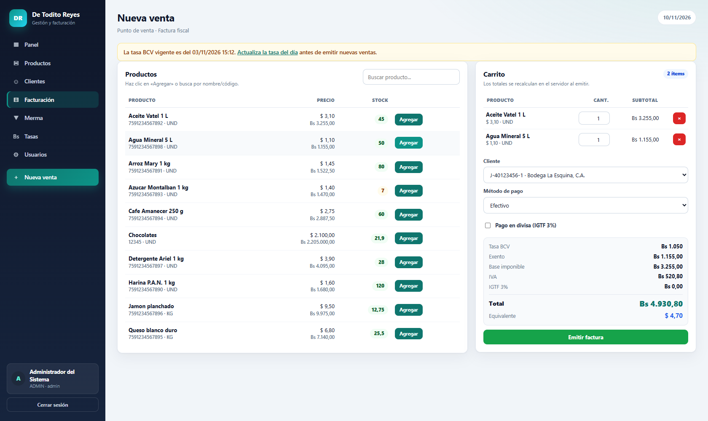

El servidor vuelve a leer precios, IVA, stock y tasa desde la base. El navegador solo envía el ID del producto y la cantidad. Si algo cambió (precio, stock, tasa), el servidor recalcula y, si no puede, revierte toda la operación.

El CAJERO utiliza exactamente la misma pantalla de venta. La diferencia está en el menú lateral: no ve **Productos**, **Tasas** ni **Usuarios**.

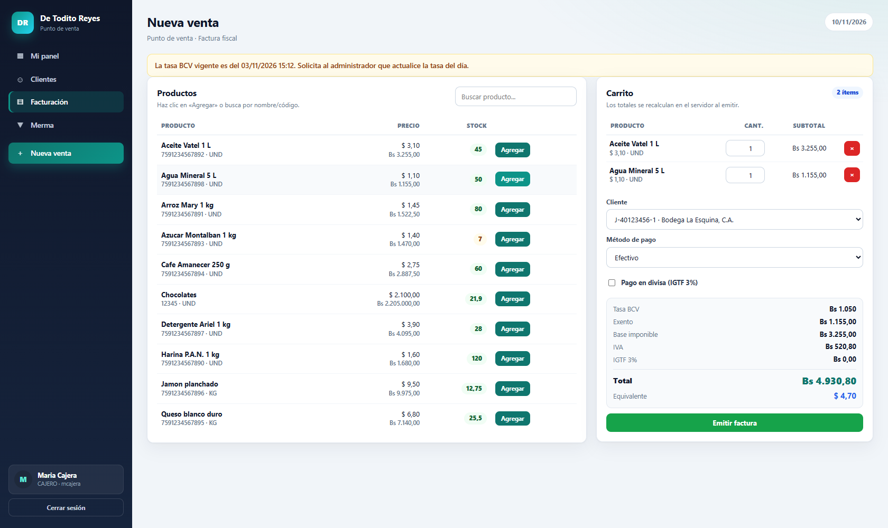

### 8.3 Qué ocurre al emitir

- Se genera un **número de factura consecutivo** de 6 dígitos (`000001`).
- Se genera un **número de control fiscal** (`00-000001`).
- Se genera un **código de verificación** aleatorio de 8 caracteres (por ejemplo `RJKRMJC2`).
- Se descuenta el stock en la misma transacción.
- Se guarda la tasa aplicada, el cliente, el cajero y el método de pago.
- Se muestra el comprobante con un aviso de éxito.

Si dos cajas emiten al mismo tiempo, el sistema usa un bloqueo y hasta 3 reintentos para que no se repita el consecutivo.

### 8.4 Errores frecuentes del POS

| Mensaje | Causa | Solución |
|---|---|---|
| “Agrega al menos un producto al carrito.” | Carrito vacío | Agrega un producto. |
| “Selecciona un cliente.” | No se eligió cliente | Selecciona uno. |
| “No hay una tasa BCV vigente...” | No hay tasa registrada | Un ADMIN debe registrar la tasa. |
| “Stock insuficiente de ... Disponible: ...” | La cantidad supera el stock | Ajusta la cantidad o repón inventario. |
| “Uno de los productos ya no está disponible.” | El producto fue desactivado o eliminado | Actualiza el catálogo. |
| “El sistema está ocupado generando otra factura...” | Otra caja tiene el bloqueo | Espera unos segundos y reintenta. |
| “No se pudo generar un número de factura único...” | Colisión persistente | Reintenta; si continúa, contacta al ADMIN. |

---

## 9. Comprobante de factura

Ruta: `/facturacion/ver/ID`. Se llega desde el historial, el panel o el aviso de emisión.

### 9.1 Contenido

- Nombre, RIF, dirección y teléfono de la empresa (configurados en `config/empresa.php`).
- Tipo **FACTURA**, número, control fiscal, código de verificación y fecha.
- Estado: `EMITIDA` o `ANULADA`.
- Cliente, RIF/cédula, dirección fiscal, método de pago, tasa aplicada y cajero.
- Líneas: producto, código, cantidad, precio USD, precio Bs, IVA y subtotal Bs.
- Totales: subtotal exento, base imponible, IVA, IGTF (si aplica), total Bs y total USD.
- Pie: agradecimiento, tipo de emisión y login del cajero.

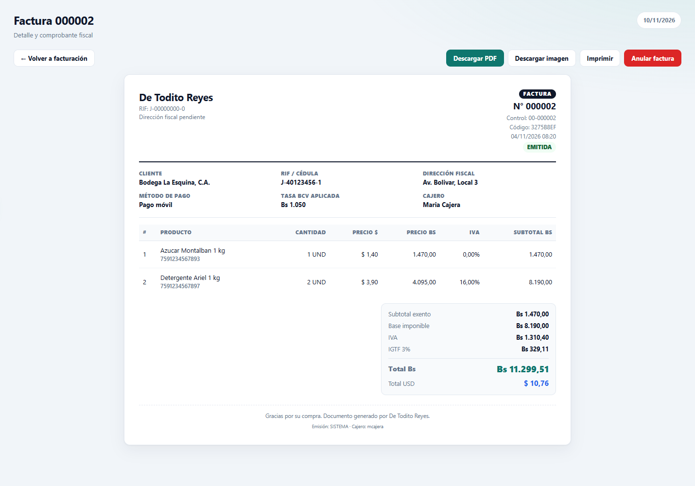

### 9.2 Acciones

| Botón | Qué hace | Quién lo ve |
|---|---|---|
| **Descargar PDF** | Descarga un PDF generado en el servidor (`/facturacion/pdf/ID`). | ADMIN y CAJERO |
| **Descargar imagen** | Descarga un PNG generado con GD (`/facturacion/imagen/ID`). | ADMIN y CAJERO |
| **Imprimir** | Abre el PDF en una pestaña nueva (`?ver=1`) para imprimir sin la URL ni la fecha que agrega Chrome. | ADMIN y CAJERO |
| **Anular factura** | Cambia el estado a `ANULADA` y devuelve el stock. Solo si está `EMITIDA`. | Solo ADMIN |
| **Eliminar factura** | Borra la factura y sus líneas. Solo si está `ANULADA`. | Solo ADMIN |

El CAJERO ve el mismo comprobante, pero sin los botones **Anular factura** ni **Eliminar factura**. Si intenta anular por URL o por un POST manipulado, el servidor rechaza la operación.

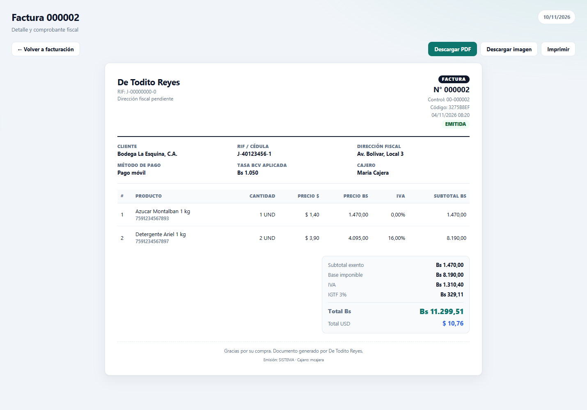

### 9.3 Anular una factura

1. Abre el comprobante de una factura `EMITIDA`.
2. Pulsa **Anular factura**.
3. Confirma la acción.

La factura queda `ANULADA`, el stock vuelve al inventario y la bitácora registra al usuario que anuló. **No se puede revertir** la anulación.

### 9.4 Eliminar una factura anulada

1. Abre una factura `ANULADA`.
2. Pulsa **Eliminar factura**.
3. Confirma.

Se borran la factura y sus líneas. El número de consecutivo no se reutiliza porque el sistema conserva el registro de emisión en la bitácora. Aun así, esta acción es delicada desde el punto de vista fiscal: úsala solo cuando corresponda y con respaldo previo.

### 9.5 PDF, PNG e impresión

- **PDF:** se genera con `PdfFactura`, sin librerías externas. No incluye la URL del sistema.
- **PNG:** se genera con `ImagenFactura` y la extensión GD. Si GD no está habilitada, el botón muestra un error; el PDF sigue funcionando.
- **Imprimir:** abre el PDF en el navegador. Si el navegador muestra su propia barra de impresión, desactiva “Encabezados y pies” para un resultado más limpio.

---

## 10. Historial de ventas

Ruta: **Facturación** (`/facturacion`).

### 10.1 Tarjetas superiores

- **Facturas de hoy:** cantidad de facturas emitidas hoy (todas, no solo las tuyas).
- **Vendido hoy (Bs):** total en Bs y USD.
- **Tasa BCV:** valor y fecha.

### 10.2 Filtros

| Campo | Uso |
|---|---|
| **Buscar** | Número de factura, control fiscal, código de verificación, cliente o RIF/cédula. |
| **Desde** | Fecha inicial (`YYYY-MM-DD`). |
| **Hasta** | Fecha final. |
| **Estado** | Todos, Emitidas o Anuladas. |
| **Filtrar** | Aplica los filtros. |
| **Limpiar** | Quita los filtros. |

El listado muestra hasta **100 facturas** (las más recientes). Las exportaciones CSV incluyen **todas** las que coincidan con los filtros, no solo las 100 visibles.

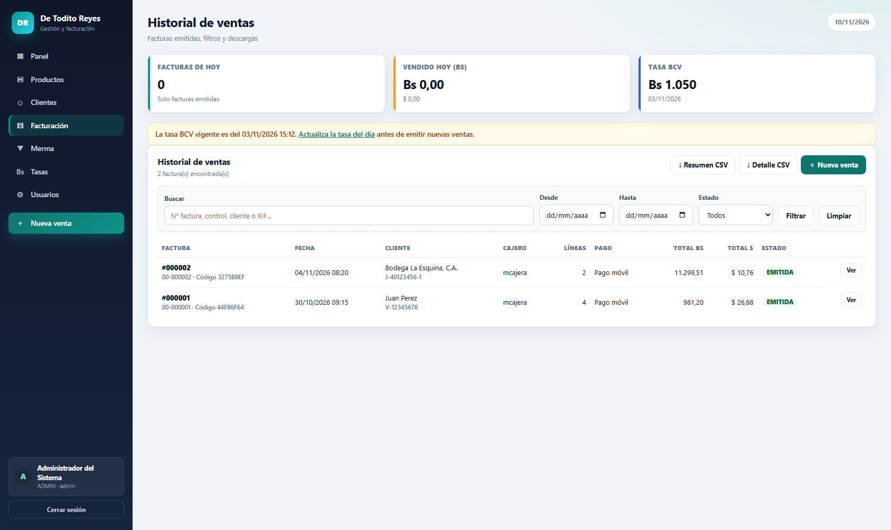

### 10.3 Exportar CSV

- **Resumen CSV:** una fila por factura. Incluye factura, control, fecha, cliente, RIF/cédula, cajero, método de pago, estado, subtotal exento, base imponible, IVA, IGTF, total Bs, total USD y tasa aplicada.
- **Detalle CSV:** una fila por producto vendido. Incluye factura, control, fecha, cliente, RIF/cédula, cajero, código, producto, unidad, cantidad/peso, precio USD, precio Bs, alícuota, IVA, subtotal y estado.

Los archivos usan UTF-8 con BOM, separador `;`, decimales con coma y punto de miles, para abrirse correctamente en Excel en español. El nombre incluye fecha y hora.

### 10.4 Abrir un comprobante

Pulsa el número de factura (`#000001`) o **Ver** para abrir el comprobante.

### 10.5 Eliminar desde el historial

El ADMIN ve el botón **Eliminar** solo en facturas `ANULADA`. Es equivalente a eliminarla desde el comprobante.

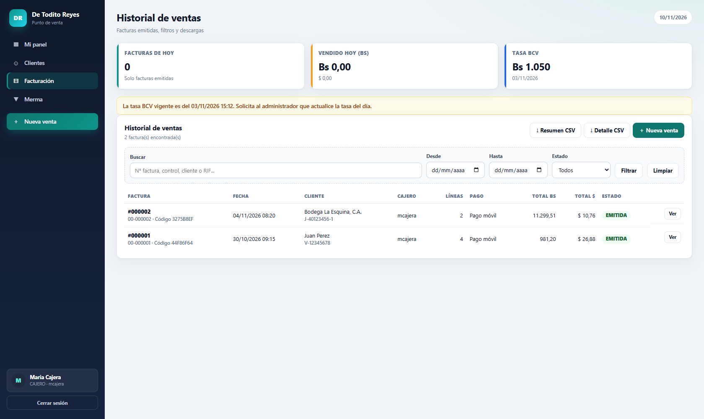

---

## 11. Tasas BCV

Ruta: **Tasas** (`/tasas`). Todos los usuarios autenticados pueden consultar; solo el ADMIN puede registrar o corregir.

### 11.1 Consultar

La pantalla muestra:

- **Tasa BCV vigente:** Bs por 1 USD.
- **Última actualización:** fecha/hora y usuario que la registró.
- **Estado:** `Al día`, `Desactualizada` o `Sin tasa`.
- **Historial de tasas:** vigencia, valor, observación y usuario.

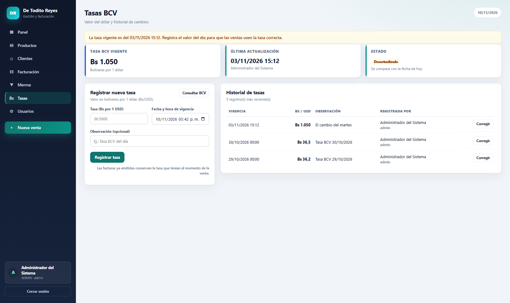

Si la tasa es de un día anterior, el panel, el POS, Facturación y Tasas muestran un aviso. El aviso no bloquea la venta, pero los totales usarán la tasa vieja hasta que se actualice.

El CAJERO puede consultar la tasa y su historial, pero no ve el formulario de registro ni el botón **Corregir**.

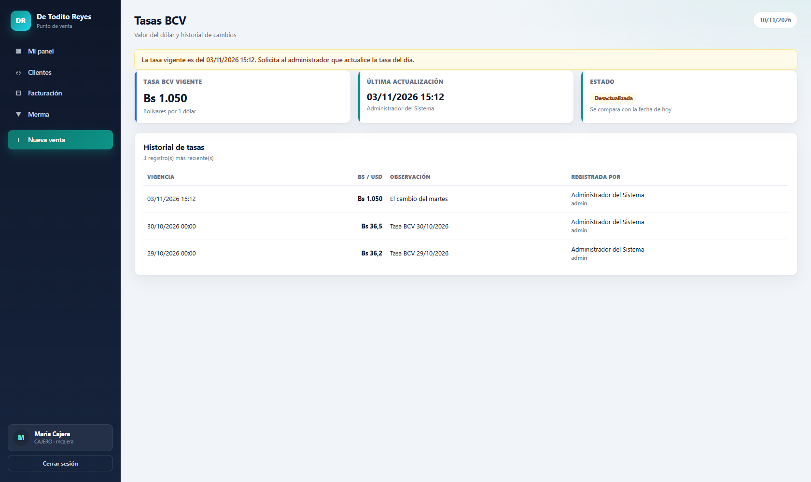

### 11.2 Registrar una tasa (ADMIN)

1. Consulta el valor oficial en [bcv.org.ve](https://www.bcv.org.ve/) con el botón **Consultar BCV**.
2. En **Registrar nueva tasa**, escribe:
   - **Tasa (Bs por 1 USD):** mayor que 0, hasta 4 decimales.
   - **Fecha y hora de vigencia:** no puede estar en el futuro (se toleran 5 minutos).
   - **Observación:** opcional, máximo 100 caracteres.
3. Pulsa **Registrar tasa**.

No se permite duplicar la misma fecha/hora. Si intentas guardar una fecha existente, el sistema avisa y no inserta.

### 11.3 Corregir una tasa (ADMIN)

1. En el historial, pulsa **Corregir** en la fila correspondiente.
2. Cambia el valor, la fecha/hora o la observación.
3. Pulsa **Guardar corrección**.

Las facturas ya emitidas conservan la tasa que tenían al momento de la venta. Corregir una tasa histórica **no** altera esos totales.

### 11.4 Buenas prácticas

- Registra la tasa al inicio de la jornada.
- Usa la fecha/hora real de vigencia.
- No corrijas tasas históricas salvo que sea imprescindible; si lo haces, deja una observación clara.
- Si eres CAJERO y la tasa está vencida, avisa al ADMIN antes de vender.

---

## 12. Mermas

Ruta: **Merma** (`/mermas`). Disponible para ADMIN y CAJERO.

Una merma es una salida de inventario por vencimiento, daño, pérdida, robo, ajuste o cualquier otro motivo. Descuenta stock y guarda el costo del momento.

### 12.1 Registrar una merma

1. Entra a **Merma**.
2. En **Reportar merma**, selecciona el **Producto** (solo aparecen productos activos).
3. Escribe la **Cantidad dada de baja** (mayor que 0 y no mayor que el stock).
4. Selecciona el **Motivo**:
   - Vencimiento
   - Daño
   - Pérdida
   - Robo
   - Ajuste de inventario
   - Otro
5. Agrega una **Observación** opcional (máximo 200 caracteres).
6. Pulsa **Registrar merma**.

El sistema descuenta el stock en una transacción y muestra un aviso con la cantidad y el stock restante.

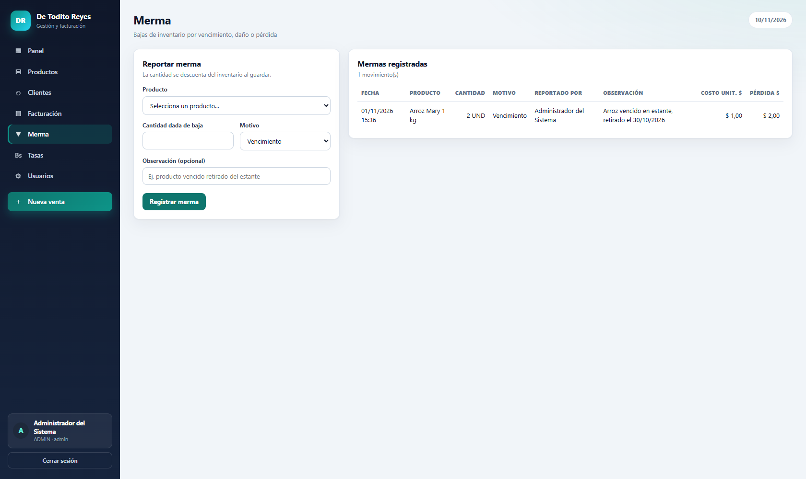

### 12.2 Consultar

La tabla muestra fecha, producto, cantidad, motivo, usuario que reportó y observación.

- **ADMIN:** además ve **Costo unit. $** y **Pérdida $** (cantidad × costo del momento).
- **CAJERO:** no ve costos ni pérdidas.

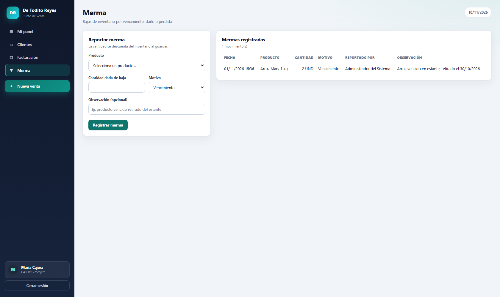

### 12.3 Errores frecuentes

| Mensaje | Causa | Solución |
|---|---|---|
| “Selecciona un producto.” | No se eligió producto | Selecciona uno. |
| “La cantidad de merma debe ser mayor que cero.” | Cantidad 0 o negativa | Escribe una cantidad válida. |
| “La cantidad supera el stock disponible...” | Más que el stock | Ajusta la cantidad. |
| “El producto seleccionado no existe o está inactivo.” | Producto desactivado | Reactívalo o elige otro. |

---

## 13. Usuarios (solo ADMIN)

Ruta: **Usuarios** (`/usuarios`).

### 13.1 Crear un usuario

1. En **Nuevo usuario**, completa:
   - **Nombre completo:** obligatorio, máximo 100 caracteres.
   - **Cédula:** obligatoria, formato `V-12345678`; única.
   - **Usuario de acceso:** entre 3 y 40 caracteres; solo minúsculas, números, punto, guion o guion bajo; único.
   - **Rol:** `CAJERO — vende y consulta` o `ADMIN — acceso total`.
   - **Contraseña:** obligatoria al crear; mínimo 6 caracteres, máximo 72.
2. Pulsa **Crear usuario**.

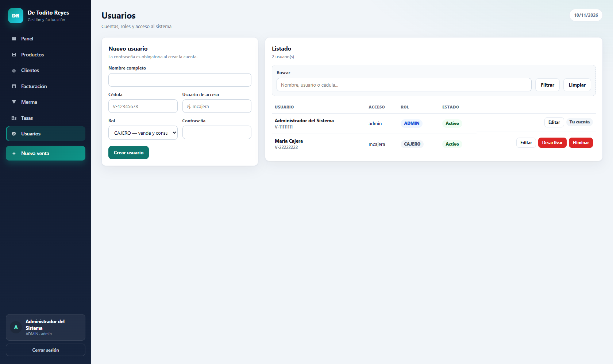

### 13.2 Editar un usuario

1. Pulsa **Editar** en la fila del usuario.
2. Cambia nombre, cédula, usuario o rol.
3. Si quieres cambiar la contraseña, escríbela en **Nueva contraseña (opcional)**. Si la dejas vacía, se conserva la actual.
4. Pulsa **Guardar cambios**.

Si un ADMIN se quita su propio rol, el sistema actualiza la sesión y lo redirige al panel; pierde el acceso a Usuarios.

### 13.3 Restablecer contraseña

Es el mismo formulario de edición: escribe la nueva contraseña y guarda. El usuario deberá usarla en su próximo inicio de sesión.

### 13.4 Activar, desactivar y eliminar

- **Desactivar:** impide el inicio de sesión y cierra la sesión activa en la siguiente petición. No borra el historial. Es la opción recomendada cuando un usuario deja el negocio.
- **Reactivar:** vuelve a permitir el acceso.
- **Eliminar:** solo se permite si el usuario **no tiene facturas, tasas, mermas ni compras**. Si tiene historial, el sistema lo rechaza y sugiere desactivarlo.

### 13.5 Protecciones

- No puedes desactivar ni eliminar tu propia cuenta.
- No se puede dejar el sistema sin al menos un ADMIN activo.
- No se puede repetir cédula ni usuario.
- La contraseña nunca se muestra en el listado.

### 13.6 Buenas prácticas

- Ten al menos dos ADMIN activos.
- Usa cuentas individuales; no compartas el usuario `admin`.
- Desactiva en lugar de eliminar cuando haya historial.
- Cambia la contraseña demo inmediatamente.

---

## 14. Preguntas frecuentes

### ¿Por qué el sistema me pide la contraseña otra vez si ya había entrado?

Porque abriste `/` o `/login` con una sesión activa. El sistema cierra la sesión anterior por seguridad y exige la contraseña de nuevo. También puede ocurrir si pasaron más de 30 minutos de inactividad.

### ¿Por qué no veo Productos, Tasas o Usuarios?

Esos módulos son solo para ADMIN. El CAJERO tiene un menú reducido a Mi panel, Clientes, Facturación, Merma y Nueva venta.

### ¿Por qué no puedo eliminar un producto?

Porque tiene ventas, compras o mermas asociadas. Para conservar la trazabilidad, desactívalo. Dejará de aparecer en el POS.

### ¿Por qué no puedo eliminar un cliente?

Porque tiene facturas asociadas. Puedes editarlo, pero no borrarlo.

### ¿Por qué no puedo eliminar un usuario?

Porque tiene facturas, tasas, mermas o compras registradas. Desactívalo para bloquear el acceso sin perder el historial.

### ¿Por qué no puedo eliminar una factura emitida?

Primero debes anularla. Solo las facturas `ANULADA` se pueden eliminar, y solo el ADMIN puede hacerlo.

### ¿Por qué el botón “Descargar imagen” da error?

La extensión GD de PHP no está habilitada. El ADMIN debe habilitar `extension=gd` en `php.ini` y reiniciar Apache. Mientras tanto, usa **Descargar PDF** o **Imprimir**.

### ¿Por qué el PDF no muestra la URL del sistema?

Porque el PDF se genera en el servidor con `PdfFactura`, no con el diálogo “Guardar como PDF” del navegador. El botón **Imprimir** abre ese mismo PDF.

### ¿Por qué la tasa aparece desactualizada?

Porque la fecha de vigencia es anterior a hoy. Un ADMIN debe registrar la tasa del día en **Tasas**. Puedes seguir vendiendo, pero con la tasa anterior.

### ¿Puedo vender sin tasa BCV?

No. El servidor rechaza la emisión si no hay una tasa mayor que cero. El POS muestra un aviso y el botón de emisión no debe usarse hasta que el ADMIN registre la tasa.

### ¿Cómo busco una factura por su código de verificación?

En **Facturación**, escribe el código en **Buscar**. También puedes buscar por número de factura, control fiscal, cliente o RIF/cédula.

### ¿El CSV se abre mal en Excel?

El archivo usa UTF-8 con BOM, separador `;` y decimales con coma. Debe abrirse directamente en Excel en español. Si tu Excel usa otro separador, importa el archivo como CSV y elige `;`.

### ¿Qué hago si veo “La sesión expiró o la solicitud no es válida” (419)?

Recarga la página, vuelve a iniciar sesión y repite la operación. No envíes el formulario dos veces con una pestaña vieja.

### ¿Qué hago si veo “No se pudo conectar con la base de datos”?

Verifica que MySQL esté iniciado en XAMPP y que la base `de_todito_reyes` exista. Si persiste, contacta al ADMIN.

### ¿Puedo usar el sistema desde el celular?

La interfaz es responsive y el menú se abre con **☰**, pero el POS está pensado para pantallas de escritorio. Para vender desde el celular, verifica que la tabla y el carrito sean cómodos en tu dispositivo.

### ¿Dónde se cambian el nombre, RIF y dirección de la empresa?

En `config/empresa.php`. Esos datos salen en el comprobante, el PDF y el PNG. Solo el ADMIN o el responsable de la instalación debe editarlos.

---

## 15. Glosario

| Término | Significado |
|---|---|
| **ADMIN** | Rol con acceso total: inventario, precios, usuarios, tasas, anulación y eliminación. |
| **CAJERO** | Rol operativo: vende, registra clientes, consulta facturas y reporta mermas. |
| **BCV** | Banco Central de Venezuela. La tasa se expresa en bolívares por 1 dólar. |
| **Tasa BCV** | Valor del dólar usado para convertir precios USD a Bs. Se registra manualmente. |
| **IVA** | Impuesto al Valor Agregado. Se calcula por producto según su alícuota. |
| **IGTF** | Impuesto a las Grandes Transacciones Financieras. En el sistema se aplica al 3% cuando se marca “Pago en divisa”. |
| **POS** | Punto de venta: pantalla de catálogo, carrito y emisión. |
| **SKU / Código** | Código único de barras o QR del producto. |
| **Merma** | Salida de inventario por vencimiento, daño, pérdida, robo o ajuste. |
| **Consecutivo** | Número fiscal de la factura, de 6 dígitos (`000001`). |
| **Control fiscal** | Número de control de la factura (`00-000001`). |
| **Código de verificación** | Código aleatorio de 8 caracteres que acompaña la factura. |
| **Comprobante** | Vista imprimible de la factura con sus datos fiscales. |
| **Anular** | Marcar una factura como `ANULADA` y devolver el stock. No se puede revertir. |
| **Eliminar** | Borrar una factura anulada y sus líneas. Solo ADMIN. |
| **Stock mínimo** | Cantidad a partir de la cual el sistema marca stock bajo. |
| **Stock máximo** | Cantidad objetivo opcional; no bloquea ventas. |
| **Flash** | Mensaje temporal de éxito, aviso o error que se muestra una vez. |
| **CSRF** | Protección contra envíos de formularios desde otro sitio. |
| **Sesión** | Periodo autenticado; expira a los 30 minutos de inactividad. |

---

## 16. Referencia rápida de URLs

| Acción | URL |
|---|---|
| Iniciar sesión | `/` o `/login` |
| Panel | `/panel` |
| Cerrar sesión | `/logout` (POST) |
| Productos | `/productos` |
| Clientes | `/clientes` |
| Facturación / historial | `/facturacion` |
| Nueva venta (POS) | `/facturacion/nueva` |
| Comprobante | `/facturacion/ver/ID` |
| Descargar PDF | `/facturacion/pdf/ID` |
| Abrir PDF para imprimir | `/facturacion/pdf/ID?ver=1` |
| Descargar PNG | `/facturacion/imagen/ID` |
| Exportar resumen CSV | `/facturacion/exportar?tipo=resumen` |
| Exportar detalle CSV | `/facturacion/exportar?tipo=detalle` |
| Mermas | `/mermas` |
| Tasas BCV | `/tasas` |
| Usuarios | `/usuarios` |

Los filtros del historial se pueden combinar:

```text
/facturacion?desde=2026-11-01&hasta=2026-11-30&estado=EMITIDA&q=texto
```

Las URLs antiguas con `.php` (por ejemplo `productos.php`) se redirigen a la ruta limpia equivalente.

---

## 17. Buenas prácticas de operación

1. **Cambia las contraseñas demo** antes de la primera venta.
2. **Registra la tasa BCV al inicio del día** y avisa al equipo si cambia.
3. **No compartas usuarios.** Cada cajero debe tener su propia cuenta para que la factura y la bitácora registren al actor correcto.
4. **Revisa el stock bajo** antes de abrir caja.
5. **Usa mermas** para bajas justificadas; no edites el stock a mano para “cuadrar”.
6. **Anula con criterio.** Una anulación devuelve stock y no se puede revertir.
7. **Evita eliminar facturas** salvo que sea estrictamente necesario y con respaldo.
8. **Descarga un respaldo** antes de cambios grandes (productos, usuarios, migraciones).
9. **Cierra sesión** al terminar el turno, especialmente en equipos compartidos.
10. **Reporta errores** con la URL, la hora, el usuario y el mensaje exacto.

---

## 18. Soporte y escalamiento

| Situación | A quién acudir |
|---|---|
| No puedo entrar | ADMIN del sistema |
| Olvidé mi contraseña (CAJERO) | ADMIN |
| Olvidé la contraseña de ADMIN | Responsable técnico con acceso a consola |
| Tasa BCV desactualizada | ADMIN |
| Error al emitir una factura | ADMIN / responsable técnico |
| PNG no descarga | Responsable técnico (habilitar GD) |
| Error de base de datos | Responsable técnico |
| Problema de red o servidor | Responsable de infraestructura |

Para reportar un problema, incluye:

- Usuario y rol.
- Fecha y hora.
- URL o módulo.
- Pasos realizados.
- Mensaje exacto (sin contraseñas).
- Si es posible, una captura de pantalla.

---

*Fin del manual de usuario.*
