# Manual de usuario — Sistema De Todito Reyes

**Versión del documento:** 1.1  
**Sistema:** De Todito Reyes — Gestión y facturación  
**Roles:** ADMIN (administrador) y CAJERO  
**Fecha:** 16 de noviembre de 2026  
**Documentos relacionados:** [Manual de instalación](MANUAL_INSTALACION.md) · [Revisión técnica](REVISION_TECNICA.md) · [Diagramas de casos de uso](casos-de-uso/)

---

## 1. Introducción

De Todito Reyes es un sistema para administrar clientes, productos, inventario, mermas, tasas de cambio del BCV y facturación en bolívares con IVA e IGTF. Está pensado para un negocio pequeño con dos perfiles:

- **ADMIN:** control total del negocio, inventario, precios, usuarios, tasas, períodos fiscales y facturas.
- **CAJERO:** opera el punto de venta, registra clientes y consulta sus propias ventas.

El sistema funciona en un navegador web. No requiere instalar programas en la computadora del cajero; solo necesita la dirección del servidor y un usuario activo.

> **Importante:** el sistema no envía correos ni mensajes automáticos. La tasa BCV se registra manualmente y las contraseñas se cambian desde el módulo **Usuarios** o, si nadie puede entrar, con el script de consola descrito en el manual de instalación.

### 1.1 Novedades de esta versión

Esta edición del manual incorpora los cambios funcionales más recientes:

- **Períodos fiscales mensuales:** el ADMIN puede cerrar un mes para bloquear la anulación y eliminación de sus facturas.
- **Pago mixto:** una venta puede pagarse en parte en divisa (USD) y en parte en bolívares (Bs).
- **Desglose de pagos:** el comprobante, el PDF y el PNG muestran cómo se pagó la factura.
- **Anulación con motivo obligatorio:** el ADMIN debe explicar por qué anula; la fecha, la hora y el usuario quedan registrados.
- **POS más ágil:** búsqueda remota de productos y clientes, paginación del catálogo y protección contra la doble emisión.
- **Permisos más estrictos:** Merma, exportación CSV, anulación, eliminación y períodos son solo para ADMIN; el CAJERO ve únicamente sus propias facturas y consulta Productos en modo lectura.

---

## 2. Requisitos para usar el sistema

- Un navegador actualizado: Chrome, Edge, Firefox o Safari.
- Conexión a la red donde está instalado el servidor.
- Usuario y contraseña activos.
- Resolución mínima recomendada: 1366 × 768. En pantallas pequeñas el menú lateral se puede abrir con el botón **☰**.

No se necesita conexión a internet para operar, salvo que se quiera consultar el valor oficial en `bcv.org.ve` desde el enlace del módulo **Tasas**.

---

## 3. Acceso al sistema

### 3.1 Dirección

La dirección depende de cómo se instaló:

| Instalación | Dirección típica |
|---|---|
| Apache con el proyecto en `htdocs` | `http://localhost/revisionSistema/public/` |
| Apache con `DocumentRoot` en `public/` | `http://localhost/` |
| Servidor embebido de PHP | `http://127.0.0.1:8000/` |

La raíz `/` siempre muestra el inicio de sesión. El panel está en `/panel` y no se puede abrir sin sesión activa.

### 3.2 Iniciar sesión

1. Abre la dirección del sistema.
2. Escribe tu **Usuario**.
3. Escribe tu **Contraseña**.
4. Pulsa **Entrar**.

Si los datos son correctos, el sistema te lleva al panel que corresponde a tu rol.

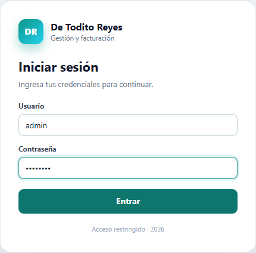

### 3.3 Credenciales de demostración

| Usuario | Contraseña | Rol |
|---|---|---|
| `admin` | `admin123` | ADMIN |
| `mcajera` | `cajera123` | CAJERO |

> **Cambia estas contraseñas antes de usar el sistema en producción.** Si las cuentas demo no se van a usar, desactívalas desde **Usuarios**.

### 3.4 Si olvidaste la contraseña

- Si eres **CAJERO**, pide al ADMIN que restablezca tu contraseña desde **Usuarios**.
- Si eres **ADMIN** y no puedes entrar, usa el script de consola `tools/crear_admin.php` (ver manual de instalación). Ese script no funciona desde el navegador.

### 3.5 Cerrar sesión

Pulsa **Cerrar sesión** al final del menú lateral. El cierre se hace por `POST` con protección CSRF; no existe un enlace `GET /logout` que cierre la sesión.

La sesión se cierra automáticamente después de **30 minutos de inactividad**. Si tu cuenta es desactivada o eliminada mientras estás conectado, la siguiente petición te llevará al login con un aviso.

### 3.6 Comportamiento del navegador

- Las páginas autenticadas no se guardan en caché. El botón **Atrás** no debe mostrar el panel después de cerrar sesión.
- Si abres `/` con una sesión abierta, el sistema cierra esa sesión y te pide la contraseña de nuevo. Es intencional.
- Si ves un error **419**, la sesión expiró o el formulario perdió el token de seguridad. Recarga la página e inténtalo de nuevo.

---

## 4. Roles y permisos

### 4.1 Tabla de permisos

| Acción | ADMIN | CAJERO |
|---|:---:|:---:|
| Iniciar y cerrar sesión | ✔ | ✔ |
| Ver el panel administrativo | ✔ | ✘ |
| Ver el panel personal de ventas | ✔ | ✔ |
| Consultar clientes | ✔ | ✔ |
| Registrar clientes nuevos | ✔ | ✔ |
| Editar o eliminar clientes | ✔ | ✘ |
| Consultar productos, precios y stock | ✔ | ✔ (solo lectura) |
| Ver el costo de los productos | ✔ | ✘ |
| Crear, editar, activar/desactivar o eliminar productos | ✔ | ✘ |
| Emitir facturas en el POS | ✔ | ✔ |
| Consultar el historial de ventas | ✔ (todas) | ✔ (solo las propias) |
| Abrir comprobantes | ✔ (todos) | ✔ (solo los propios) |
| Descargar PDF, PNG o imprimir | ✔ | ✔ (solo facturas propias) |
| Exportar resumen o detalle CSV | ✔ | ✘ |
| Consultar la tasa BCV vigente | ✔ | ✔ (en el panel, Facturación y POS) |
| Consultar el historial de tasas | ✔ | ✔ (solo lectura, por URL directa) |
| Registrar o corregir la tasa BCV | ✔ | ✘ |
| Anular facturas | ✔ | ✘ |
| Eliminar facturas anuladas | ✔ | ✘ |
| Registrar o consultar mermas | ✔ | ✘ |
| Ver costos y pérdidas por merma | ✔ | ✘ |
| Cerrar o reabrir períodos fiscales | ✔ | ✘ |
| Gestionar usuarios | ✔ | ✘ |

### 4.2 Menú según el rol

**ADMIN:**

- Panel
- Productos
- Clientes
- Facturación
- Períodos
- Merma
- Tasas
- Usuarios
- Nueva venta

**CAJERO:**

- Mi panel
- Productos
- Clientes
- Facturación
- Nueva venta

El CAJERO no ve **Períodos**, **Merma**, **Tasas** ni **Usuarios**. Si intenta abrir `/periodos`, `/mermas` o `/usuarios` escribiendo la dirección, el servidor lo devuelve a su panel con el aviso “Solo un administrador puede realizar esa acción.”

El CAJERO sí puede abrir **Productos**, pero en modo consulta: no ve costos ni botones para crear, editar, desactivar o eliminar. Las restricciones no dependen de ocultar botones: se validan en el servidor.

---

## 5. Panel principal

### 5.1 Panel del ADMIN

Al entrar como ADMIN, el panel muestra:

| Tarjeta o sección | Qué significa |
|---|---|
| Productos activos | Cantidad de productos con `activo = 1` y número de categorías. |
| Clientes | Total de clientes registrados. |
| Facturas emitidas | Total de facturas en estado `EMITIDA`. |
| Tasa BCV vigente | Valor del dólar y fecha de vigencia. Si está desactualizada, aparece un enlace a **Tasas**. |
| Inventario a costo | Valor del stock actual multiplicado por el costo en USD. |
| Inventario a precio de venta | Valor del stock actual multiplicado por el precio de venta en USD. |
| Total vendido | Suma de facturas emitidas en USD y Bs. |
| Merma | Mermas registradas, mermas del mes, pérdida acumulada y pérdida del mes, con las últimas mermas. |
| Stock bajo | Productos en o por debajo del stock mínimo, con el faltante. |
| Más vendidos | Top 5 de productos por cantidad vendida. |
| Últimas facturas | Movimientos recientes con enlace al comprobante. |

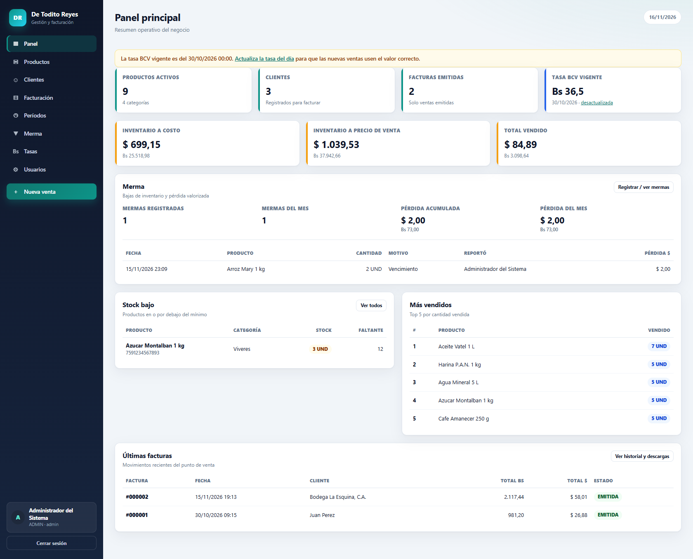

### 5.2 Panel del CAJERO (“Mi panel”)

El CAJERO ve solo su actividad:

- **Tus facturas de hoy:** cantidad de facturas emitidas hoy por su usuario.
- **Vendido hoy:** total en Bs y USD de sus ventas de hoy.
- **Facturas del mes:** cantidad y total vendido en el mes.
- **Tasa BCV vigente:** valor y fecha; si está desactualizada, aviso para pedir al ADMIN.
- **Accesos rápidos:** botones **Nueva venta** e **Historial de ventas**.
- **Tu actividad:** facturas emitidas, total vendido y última venta.
- **Tus últimas facturas:** movimientos recientes emitidos por su usuario.

El panel del CAJERO **no** muestra inventario, costos, pérdidas, mermas, productos ni datos de otros usuarios.

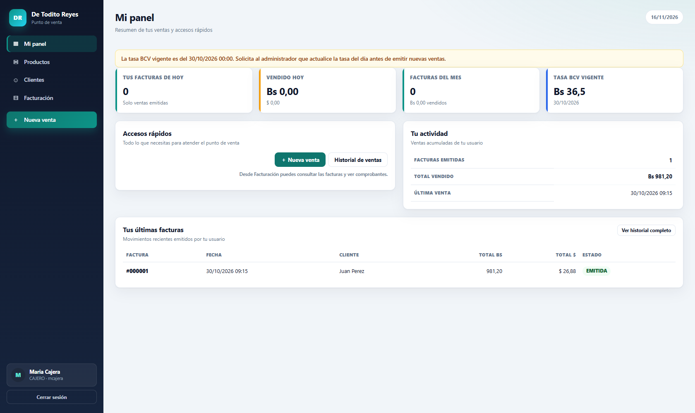

---

## 6. Clientes

Ruta: **Clientes** (`/clientes`).

### 6.1 Consultar

1. Entra a **Clientes**.
2. Usa el campo **Buscar** por nombre, cédula o RIF.
3. Pulsa **Filtrar**.
4. Pulsa **Limpiar** para ver todos.

La tabla muestra cliente, RIF/cédula, teléfono, dirección y cantidad de facturas.

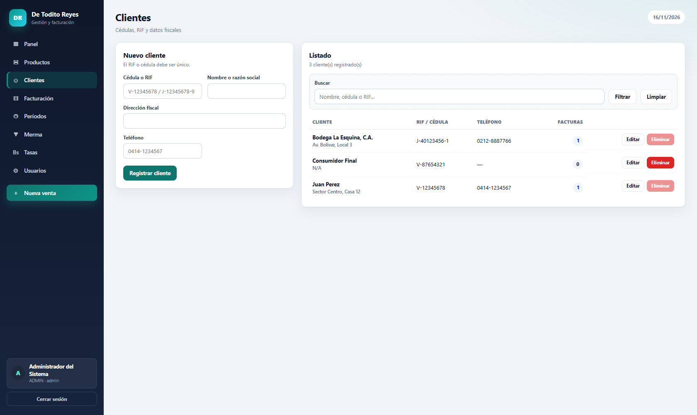

### 6.2 Registrar un cliente

Pueden hacerlo ADMIN y CAJERO.

1. En **Nuevo cliente**, completa:
   - **Cédula o RIF:** obligatorio. Formato `V-12345678` o `J-12345678-9`. Letras permitidas: `V`, `E`, `J`, `G`, `P`; guion; entre 6 y 9 dígitos; opcional un dígito final.
   - **Nombre o razón social:** obligatorio, máximo 120 caracteres.
   - **Dirección fiscal:** opcional, máximo 180 caracteres.
   - **Teléfono:** opcional, máximo 25 caracteres.
2. Pulsa **Registrar cliente**.
3. Si el RIF/cédula ya existe, el sistema muestra “Ya existe otro cliente con esa cédula o RIF.”

### 6.3 Editar o eliminar

Solo el ADMIN ve los botones **Editar** y **Eliminar**.

- **Editar:** abre el formulario con los datos actuales; pulsa **Guardar cambios**.
- **Eliminar:** solo se permite si el cliente **no tiene facturas**. Si tiene, el botón aparece deshabilitado y el servidor también rechaza el borrado. En ese caso, edita los datos en lugar de borrar.

El CAJERO puede consultar y crear clientes, pero no editar ni eliminar. Si lo intenta por URL o por un POST manipulado, el servidor responde con “Solo un administrador puede editar o eliminar clientes.”

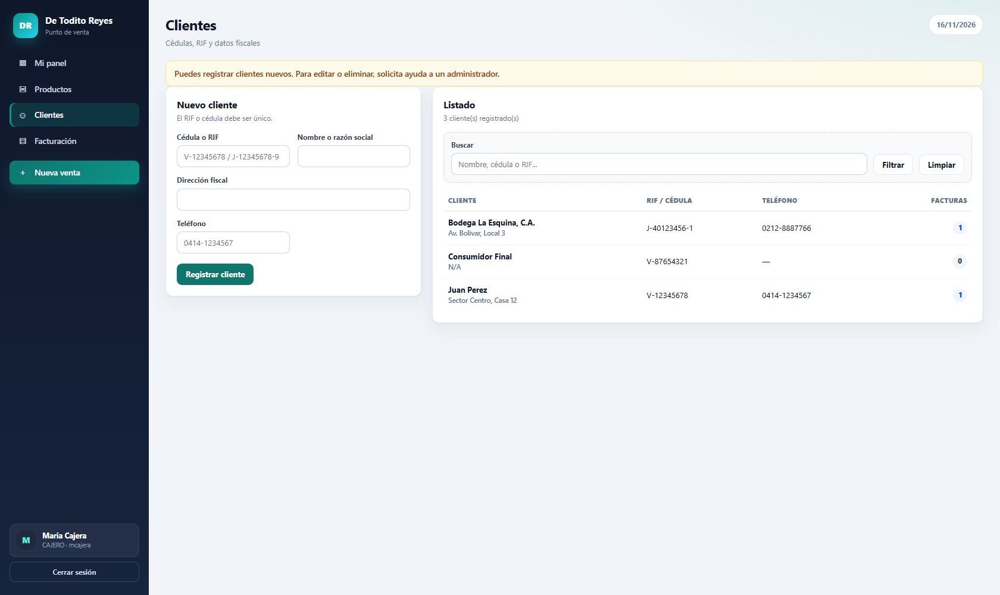

---

## 7. Productos e inventario

Ruta: **Productos** (`/productos`). El ADMIN administra el catálogo; el CAJERO puede consultarlo en modo lectura.

### 7.1 Conceptos importantes

- **Costo en USD:** lo que cuesta adquirir el producto.
- **Precio de venta en USD:** lo que se cobra al cliente.
- **Costo/Precio en Bs (BCV):** campo de referencia calculado con la tasa vigente. No se guarda en la base; el POS aplica la tasa del momento de la venta.
- **Alícuota IVA:** porcentaje de IVA del producto. Valores habituales: `0` (exento), `8` (reducida) y `16` (general). Se permiten valores entre 0 y 100.
- **Stock actual / mínimo / máximo:** cantidades en la unidad de medida. El stock máximo es opcional.

### 7.2 Crear un producto (ADMIN)

1. Entra a **Productos**.
2. En **Nuevo producto**, completa:
   - **Nombre del producto:** obligatorio, máximo 120 caracteres.
   - **Código de barras / QR:** obligatorio, máximo 64 caracteres y único.
   - **Categoría:** obligatoria.
   - **Unidad de medida:** Unidad (`UND`), Kilogramo (`KG`), Litro (`LT`), Gramo (`GR`) o Paquete (`PAQ`).
   - **Alícuota IVA (%):** 0, 8 o 16, o el valor que corresponda.
   - **Costo en USD:** mayor o igual a 0.
   - **Precio de venta en USD:** mayor o igual a 0.
   - **Stock actual**, **Stock mínimo** y, si aplica, **Stock máximo:** mayores o iguales a 0.
3. Pulsa **Crear producto**.

Si no hay tasa BCV registrada, el sistema avisa que no puede calcular los equivalentes en Bs. Puedes guardar el producto igualmente; el cálculo en Bs se actualizará cuando exista una tasa.

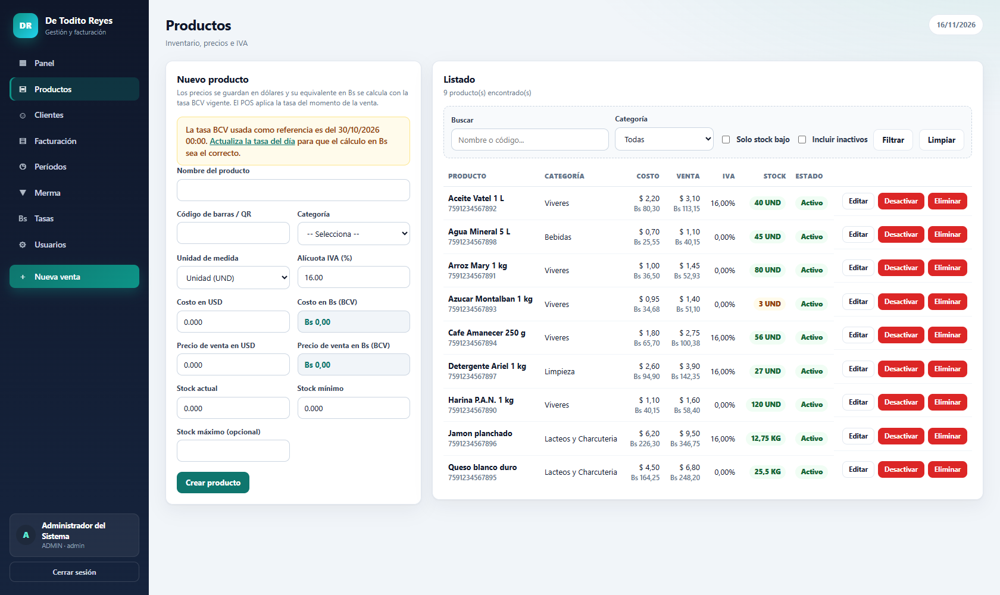

### 7.3 Editar, activar y desactivar (ADMIN)

- **Editar:** abre el formulario con los datos actuales. Pulsa **Guardar cambios**.
- **Desactivar:** el producto deja de aparecer en el POS y en los listados por defecto, pero conserva su historial. Pulsa **Reactivar** para volver a usarlo.
- **Eliminar:** solo se permite si el producto **no tiene ventas, compras ni mermas**. Si tiene historial, el sistema lo rechaza y sugiere desactivarlo.

### 7.4 Buscar y filtrar

- **Buscar:** por nombre o código.
- **Categoría:** filtra por categoría.
- **Solo stock bajo:** muestra productos con `stock_actual <= stock_minimo`.
- **Incluir inactivos:** muestra también los desactivados.
- **Limpiar:** quita todos los filtros.

La tabla muestra costo y precio en USD con su equivalente en Bs, IVA, stock con color (verde/amarillo/rojo) y estado.

### 7.5 Modo consulta del CAJERO

El CAJERO entra a **Productos** y ve un aviso: “Modo consulta: solo un administrador puede crear, editar o desactivar productos.”

Puede:

- Buscar por nombre o código.
- Filtrar por categoría, stock bajo o inactivos.
- Consultar precio de venta, IVA y stock disponible.

No puede:

- Ver el costo del producto.
- Crear, editar, desactivar, reactivar o eliminar productos.
- Cambiar precios ni stock.

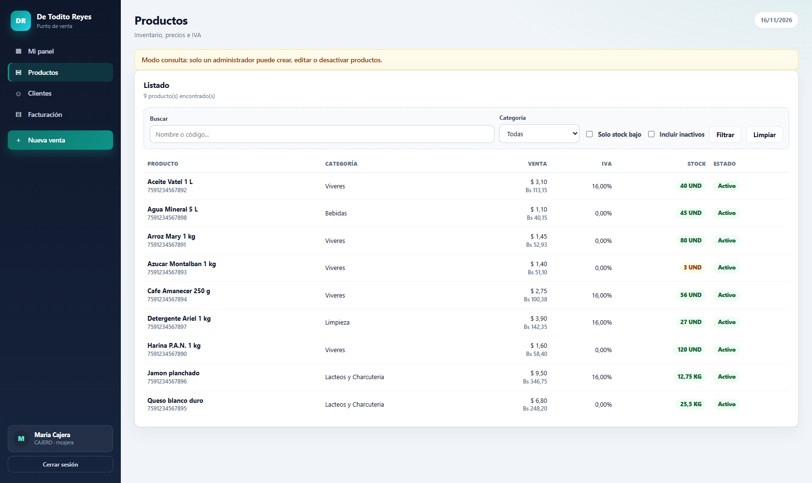

### 7.6 Buenas prácticas de inventario

- Usa códigos únicos y legibles.
- Revisa el **Stock bajo** del panel antes de abrir caja.
- No cambies el stock actual para “cuadrar” ventas: usa **Merma** para bajas justificadas.
- Desactiva en lugar de eliminar cuando el producto ya tenga historial.
- Si eres CAJERO y un precio o stock no coincide con la etiqueta, avisa al ADMIN antes de vender.

---

## 8. Punto de venta (POS)

Ruta: **Nueva venta** (`/facturacion/nueva`). Disponible para ADMIN y CAJERO.

### 8.1 Antes de vender

Verifica:

1. Que exista una **tasa BCV** registrada. Sin tasa, el servidor no permite emitir.
2. Que la tasa sea del día. Si está desactualizada, el sistema muestra un aviso; puedes vender, pero los totales usarán esa tasa.
3. Que haya **clientes** registrados. Si no hay, el POS muestra un enlace para crear uno.
4. Que haya **productos activos** con stock. Si no hay, muestra un enlace a Productos (el CAJERO puede consultar, pero no crear).

### 8.2 Pasos para emitir una factura

1. Entra a **Nueva venta**.
2. En el catálogo, busca el producto por **nombre o código** y pulsa **Agregar**.
   - El catálogo muestra **60 productos por página**. Usa **Anterior** y **Siguiente** para recorrerlo.
   - El contador indica el rango visible: “Mostrando 1-60 de N”.
   - La búsqueda consulta el catálogo completo, no solo la página visible.
   - Los productos sin stock tienen el botón **Agregar** deshabilitado.
3. En el **Carrito**, ajusta la **Cantidad**.
   - No puede superar el stock disponible.
   - Se permiten hasta 3 decimales para productos por peso o volumen.
   - Pulsa **×** para quitar una línea.
4. Selecciona el **Cliente**.
   - Puedes escribir en **Buscar por nombre o RIF** para filtrar la lista.
   - El POS carga los primeros 100 clientes y busca el resto en el servidor.
5. Selecciona el **Método de pago**: Efectivo, Pago móvil, Punto de venta, Transferencia, Zelle o Mixto.
6. Define el tratamiento del **IGTF**:
   - **Efectivo, Pago móvil, Punto de venta o Transferencia:** marca **Pago en divisa (IGTF 3%)** solo si la venta se paga en divisa. El IGTF se calcula sobre el subtotal más IVA.
   - **Zelle:** el sistema marca y aplica el IGTF automáticamente.
   - **Mixto:** no se usa la casilla; se completa el monto en divisa y el resto en bolívares (ver 8.3).
7. Revisa el resumen:
   - Tasa BCV
   - Exento
   - Base imponible
   - IVA
   - IGTF 3% (si aplica)
   - Total en Bs
   - Equivalente en USD
8. Pulsa **Emitir factura**.

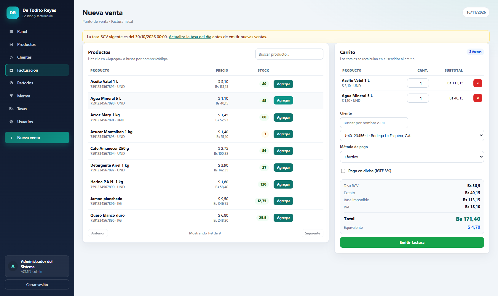

El servidor vuelve a leer precios, IVA, stock y tasa desde la base. El navegador solo envía el ID del producto y la cantidad. Si algo cambió (precio, stock, tasa), el servidor recalcula y, si no puede, revierte toda la operación.

El CAJERO utiliza exactamente la misma pantalla de venta. La diferencia está en el menú lateral: no ve Períodos, Merma, Tasas ni Usuarios, y Productos aparece en modo consulta.

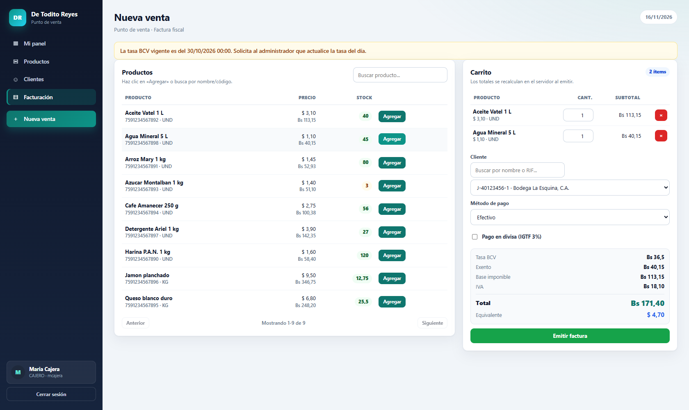

### 8.3 Pago mixto (divisa + bolívares)

El método **Mixto** sirve cuando una parte de la venta se paga en divisa (USD) y el resto en bolívares (Bs).

1. Selecciona **Mixto** en **Método de pago**.
2. En **Monto en divisa (USD)**, escribe la parte que se paga en dólares.
3. El sistema calcula automáticamente:
   - El equivalente en bolívares de la porción en divisa.
   - El **IGTF 3%** aplicado **solo a la porción en divisa**.
   - El **resto en bolívares** que completa el total.
4. Revisa la línea informativa: “Divisa: Bs … · IGTF: Bs … · Resto en Bs: …”.
5. Ajusta el **Monto en bolívares (Bs)** si el cliente entrega un monto distinto. La suma de la porción en divisa y la porción en bolívares debe coincidir con el total.
6. Pulsa **Emitir factura**.

Reglas del pago mixto:

- La porción en divisa **no puede superar el total** de la venta.
- Los montos **no pueden ser negativos**.
- Si la suma no coincide con el total, el navegador avisa antes de enviar y el servidor también rechaza la operación.
- El IGTF se calcula únicamente sobre la porción en divisa; la porción en bolívares no genera IGTF.
- La factura guarda **dos pagos** separados (USD y VES) y el comprobante los muestra en el **Desglose de pagos**.

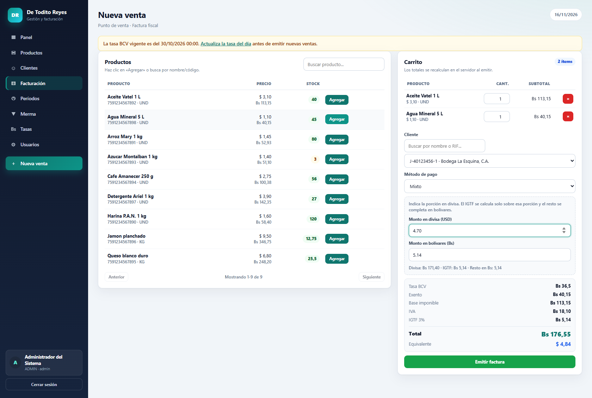

### 8.4 Qué ocurre al emitir

- Se genera un **número de factura consecutivo** de 6 dígitos (`000001`).
- Se genera un **número de control fiscal** (`00-000001`).
- Se genera un **código de verificación** aleatorio de 8 caracteres (por ejemplo `RJKRMJC2`).
- Se descuenta el stock en la misma transacción.
- Se guarda la tasa aplicada, el cliente, el cajero, el método de pago y el **desglose de pagos**.
- Se muestra el comprobante con un aviso de éxito.

**Protección contra doble emisión:** cada pestaña del POS recibe un token de emisión. El token se consume una sola vez, dura un máximo de 2 horas y se pueden tener hasta 10 formularios abiertos. Si haces doble clic, reenvías el formulario o usas una pestaña vieja, el sistema rechaza la segunda emisión con el mensaje “La solicitud de emisión ya fue procesada o expiró. Revisa el carrito e intenta de nuevo.”

**Validación de cambios:** si la tasa BCV o el precio de un producto cambian mientras la venta está abierta, el servidor rechaza la emisión para que no se cobre un importe distinto al mostrado. El carrito se conserva para que puedas revisarlo y reintentar.

Si dos cajas emiten al mismo tiempo, el sistema reserva el consecutivo de forma atómica y reintenta hasta 3 veces si hay una colisión.

### 8.5 Errores frecuentes del POS

| Mensaje | Causa | Solución |
|---|---|---|
| “Agrega al menos un producto al carrito.” | Carrito vacío | Agrega un producto. |
| “Selecciona un cliente.” | No se eligió cliente | Selecciona uno. |
| “No hay una tasa BCV vigente...” | No hay tasa registrada | Un ADMIN debe registrar la tasa. |
| “Stock insuficiente de ... Disponible: ...” | La cantidad supera el stock | Ajusta la cantidad o repón inventario. |
| “Uno de los productos ya no está disponible.” | El producto fue desactivado o eliminado | Actualiza el catálogo. |
| “La solicitud de emisión ya fue procesada o expiró...” | Doble clic, reenvío o token vencido | Vuelve a abrir **Nueva venta** y repite la operación. |
| “La tasa BCV cambió mientras la venta estaba abierta...” | Un ADMIN actualizó la tasa | Recarga el POS y revisa los totales. |
| “El precio de ... cambió mientras la venta estaba abierta...” | Un ADMIN cambió el precio | Recarga el POS y revisa los totales. |
| “Los pagos no coinciden con el total...” | La suma de divisa y bolívares no cubre el total | Ajusta el monto en bolívares o en divisa. |
| “La porción en divisa no puede superar el total de la venta.” | El monto en USD es demasiado alto | Reduce la porción en divisa. |
| “Los montos de pago no pueden ser negativos.” | Monto negativo | Corrige los montos. |
| “No se pudo descontar el stock del producto ...” | Otra caja vendió el mismo stock | Revisa el inventario y reintenta. |
| “No se pudo reservar el número de factura...” | Problema al reservar el consecutivo | Reintenta; si continúa, contacta al ADMIN. |
| “No se pudo generar un número de factura único...” | Colisión persistente | Reintenta; si continúa, contacta al ADMIN. |

---

## 9. Comprobante de factura

Ruta: `/facturacion/ver/ID`. Se llega desde el historial, el panel o el aviso de emisión.

### 9.1 Contenido

- Nombre, RIF, dirección y teléfono de la empresa (configurados en `config/empresa.php`).
- Tipo **FACTURA**, número, control fiscal, código de verificación y fecha.
- Estado: `EMITIDA` o `ANULADA`.
- Cliente, RIF/cédula, dirección fiscal, método de pago, tasa aplicada y cajero.
- Líneas: producto, código, cantidad, precio USD, precio Bs, IVA y subtotal Bs.
- Totales: subtotal exento, base imponible, IVA, IGTF (si aplica), total Bs y total USD.
- **Desglose de pagos:** método, moneda (divisa USD o bolívares), monto y equivalente en Bs. Aparece incluso en las facturas con un solo pago.
- Pie: agradecimiento, tipo de emisión y login del cajero.
- Si la factura está **ANULADA**, muestra el motivo, la fecha/hora y el usuario que la anuló.

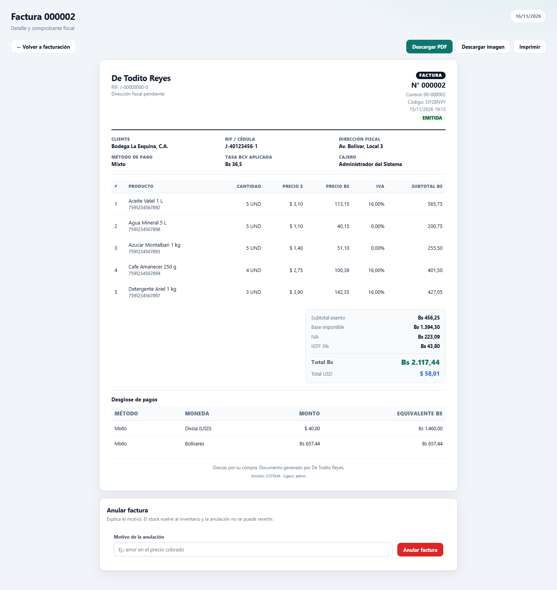

### 9.2 Acciones

| Botón | Qué hace | Quién lo ve |
|---|---|---|
| **Descargar PDF** | Descarga un PDF generado en el servidor (`/facturacion/pdf/ID`). | ADMIN y CAJERO |
| **Descargar imagen** | Descarga un PNG generado con GD (`/facturacion/imagen/ID`). | ADMIN y CAJERO |
| **Imprimir** | Abre el PDF en una pestaña nueva (`?ver=1`) para imprimir sin la URL ni la fecha que agrega Chrome. | ADMIN y CAJERO |
| **Anular factura** | Pide un motivo, cambia el estado a `ANULADA` y devuelve el stock. Solo si está `EMITIDA`. | Solo ADMIN |
| **Eliminar factura** | Borra la factura y sus líneas. Solo si está `ANULADA`. | Solo ADMIN |

El CAJERO ve el mismo comprobante, pero sin los botones **Anular factura** ni **Eliminar factura**. Además, solo puede abrir sus propias facturas: si intenta abrir la factura de otro usuario, el sistema muestra “La factura solicitada no existe.”

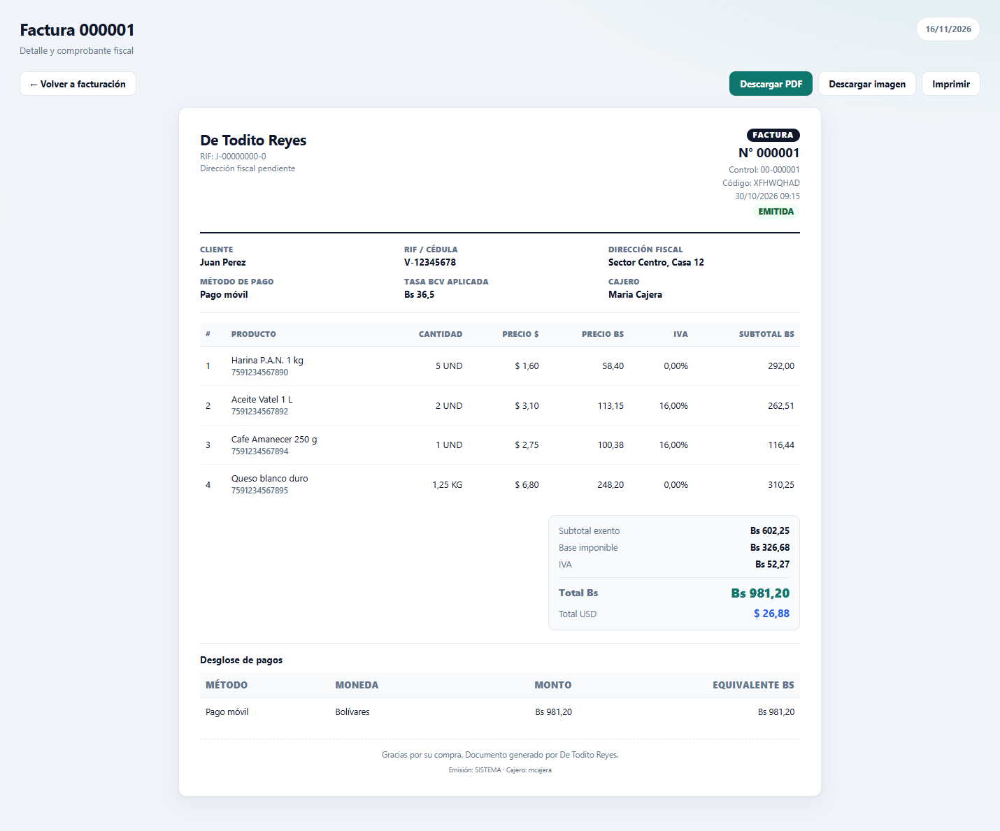

### 9.3 Anular una factura (ADMIN)

1. Abre el comprobante de una factura `EMITIDA`.
2. Baja hasta la sección **Anular factura**.
3. Escribe el **Motivo de la anulación**. Debe tener entre 5 y 200 caracteres; por ejemplo: “Error en el precio cobrado”.
4. Pulsa **Anular factura** y confirma.

La factura queda `ANULADA`, el stock vuelve al inventario y se guardan el motivo, la fecha/hora y el usuario que anuló. **No se puede revertir** la anulación.

Si el período fiscal de la factura está cerrado, el sistema rechaza la operación con “El período fiscal de esta factura está cerrado. Un administrador debe reabrirlo antes de anular.” En ese caso, primero reabre el período en **Períodos**.

### 9.4 Eliminar una factura anulada (ADMIN)

1. Abre una factura `ANULADA`.
2. Pulsa **Eliminar factura**.
3. Confirma.

Se borran la factura y sus líneas. El número de consecutivo no se reutiliza porque la secuencia fiscal avanza y la bitácora conserva el registro. Esta acción es delicada desde el punto de vista fiscal: úsala solo cuando corresponda y con respaldo previo.

Si el período fiscal está cerrado, el sistema rechaza la eliminación con “El período fiscal de esta factura está cerrado. Un administrador debe reabrirlo antes de eliminarla.”

### 9.5 PDF, PNG e impresión

- **PDF:** se genera con `PdfFactura`, sin librerías externas. No incluye la URL del sistema. Incluye el desglose de pagos y, si está anulada, el motivo y el usuario.
- **PNG:** se genera con `ImagenFactura` y la extensión GD. Si GD no está habilitada, el botón muestra un error; el PDF sigue funcionando. También incluye el desglose y los datos de anulación.
- **Imprimir:** abre el PDF en el navegador. Si el navegador muestra su propia barra de impresión, desactiva “Encabezados y pies” para un resultado más limpio.

---

## 10. Historial de ventas

Ruta: **Facturación** (`/facturacion`).

### 10.1 Tarjetas superiores

- **Facturas de hoy:** cantidad de facturas emitidas hoy. El ADMIN ve todas; el CAJERO solo las suyas.
- **Vendido hoy (Bs):** total en Bs y USD. El ADMIN ve el total del negocio; el CAJERO, solo su venta.
- **Tasa BCV:** valor y fecha.

### 10.2 Filtros

| Campo | Uso |
|---|---|
| **Buscar** | Número de factura, control fiscal, código de verificación, cliente o RIF/cédula. |
| **Desde** | Fecha inicial (`YYYY-MM-DD`). |
| **Hasta** | Fecha final. |
| **Estado** | Todos, Emitidas o Anuladas. |
| **Filtrar** | Aplica los filtros. |
| **Limpiar** | Quita los filtros. |

El listado muestra hasta **100 facturas** (las más recientes). El ADMIN ve las facturas de todos los usuarios; el CAJERO ve únicamente las que emitió con su usuario. La restricción se aplica en el servidor, no solo en la pantalla.

Las exportaciones CSV incluyen **todas** las facturas que coincidan con los filtros, no solo las 100 visibles. Solo el ADMIN puede exportar.

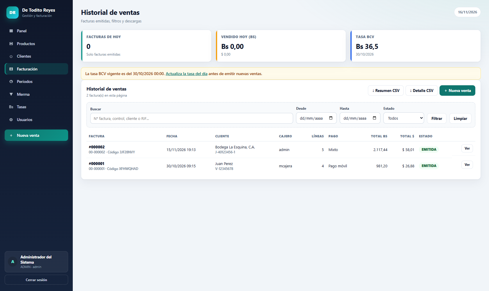

### 10.3 Exportar CSV (solo ADMIN)

- **Resumen CSV:** una fila por factura. Incluye factura, control, fecha, cliente, RIF/cédula, cajero, método de pago, estado, subtotal exento, base imponible, IVA, IGTF, total Bs, total USD y tasa aplicada.
- **Detalle CSV:** una fila por producto vendido. Incluye factura, control, fecha, cliente, RIF/cédula, cajero, código, producto, unidad, cantidad/peso, precio USD, precio Bs, alícuota, IVA, subtotal y estado.

Los archivos usan UTF-8 con BOM, separador `;`, decimales con coma y punto de miles, para abrirse correctamente en Excel en español. El nombre incluye fecha y hora.

El CAJERO no ve los botones **Resumen CSV** ni **Detalle CSV**. Si intenta abrir `/facturacion/exportar` por URL, el servidor lo devuelve a su panel con “Solo un administrador puede realizar esa acción.”

### 10.4 Abrir un comprobante

Pulsa el número de factura (`#000001`) o **Ver** para abrir el comprobante. El CAJERO solo puede abrir los comprobantes de sus propias facturas.

### 10.5 Eliminar desde el historial (solo ADMIN)

El ADMIN ve el botón **Eliminar** solo en facturas `ANULADA`. Es equivalente a eliminarla desde el comprobante. Si el período fiscal está cerrado, la operación se rechaza.

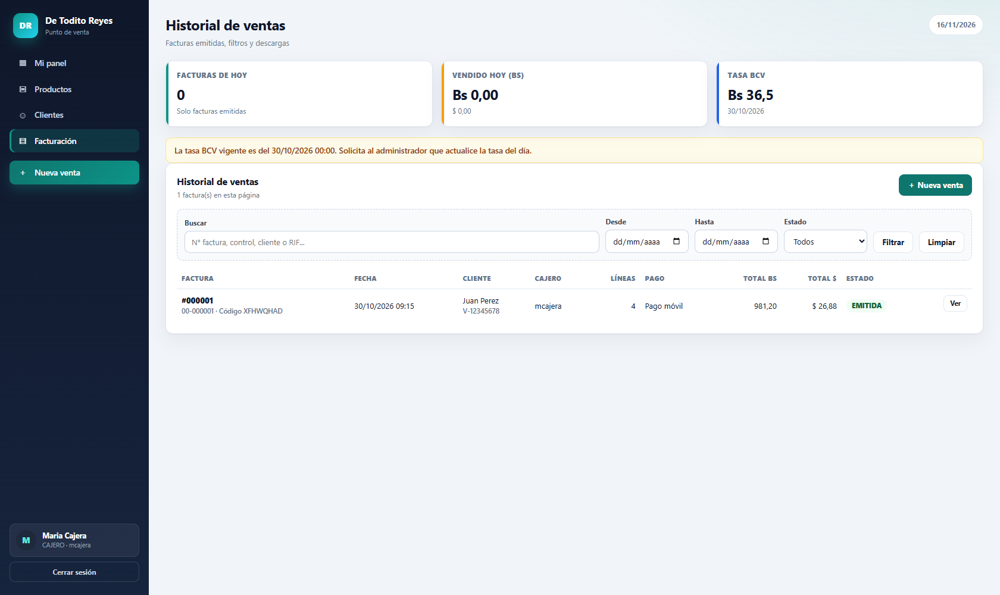

---

## 11. Tasas BCV

Ruta: **Tasas** (`/tasas`). En el menú aparece solo para el ADMIN; el CAJERO consulta la tasa vigente en su panel, en Facturación y en el POS.

### 11.1 Consultar

La pantalla muestra:

- **Tasa BCV vigente:** Bs por 1 USD.
- **Última actualización:** fecha/hora y usuario que la registró.
- **Estado:** `Al día`, `Desactualizada` o `Sin tasa`.
- **Historial de tasas:** vigencia, valor, observación y usuario.

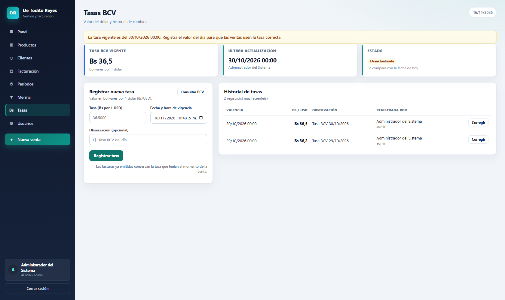

Si la tasa es de un día anterior, el panel, el POS, Facturación y Tasas muestran un aviso. El aviso no bloquea la venta, pero los totales usarán la tasa vieja hasta que se actualice.

El CAJERO no ve **Tasas** en el menú. Si abre `/tasas` por una URL directa, puede consultar el historial en modo lectura, sin formulario ni botón **Corregir**. Para el trabajo diario le basta con la tasa que aparece en su panel y en el POS.

### 11.2 Registrar una tasa (ADMIN)

1. Consulta el valor oficial en [bcv.org.ve](https://www.bcv.org.ve/) con el botón **Consultar BCV**.
2. En **Registrar nueva tasa**, escribe:
   - **Tasa (Bs por 1 USD):** mayor que 0, hasta 4 decimales.
   - **Fecha y hora de vigencia:** no puede estar en el futuro (se toleran 5 minutos).
   - **Observación:** opcional, máximo 100 caracteres.
3. Pulsa **Registrar tasa**.

No se permite duplicar la misma fecha/hora. Si intentas guardar una fecha existente, el sistema avisa y no inserta.

### 11.3 Corregir una tasa (ADMIN)

1. En el historial, pulsa **Corregir** en la fila correspondiente.
2. Cambia el valor, la fecha/hora o la observación.
3. Pulsa **Guardar corrección**.

Las facturas ya emitidas conservan la tasa que tenían al momento de la venta. Corregir una tasa histórica **no** altera esos totales.

### 11.4 Buenas prácticas

- Registra la tasa al inicio de la jornada.
- Usa la fecha/hora real de vigencia.
- No corrijas tasas históricas salvo que sea imprescindible; si lo haces, deja una observación clara.
- Si eres CAJERO y la tasa está vencida, avisa al ADMIN antes de vender.

---

## 12. Mermas (solo ADMIN)

Ruta: **Merma** (`/mermas`). **Solo el ADMIN** puede registrar y consultar mermas.

Una merma es una salida de inventario por vencimiento, daño, pérdida, robo, ajuste o cualquier otro motivo. Descuenta stock y guarda el costo del momento.

> El CAJERO no ve **Merma** en el menú. Si intenta abrir `/mermas`, el servidor lo devuelve a su panel con el aviso “Solo un administrador puede realizar esa acción.” Esto protege un ajuste que afecta el valor del inventario y las pérdidas del negocio.

### 12.1 Registrar una merma

1. Entra a **Merma**.
2. En **Reportar merma**, selecciona el **Producto** (solo aparecen productos activos).
3. Escribe la **Cantidad dada de baja** (mayor que 0 y no mayor que el stock).
4. Selecciona el **Motivo**:
   - Vencimiento
   - Daño
   - Pérdida
   - Robo
   - Ajuste de inventario
   - Otro
5. Agrega una **Observación** opcional (máximo 200 caracteres).
6. Pulsa **Registrar merma**.

El sistema descuenta el stock en una transacción y muestra un aviso con la cantidad y el stock restante.

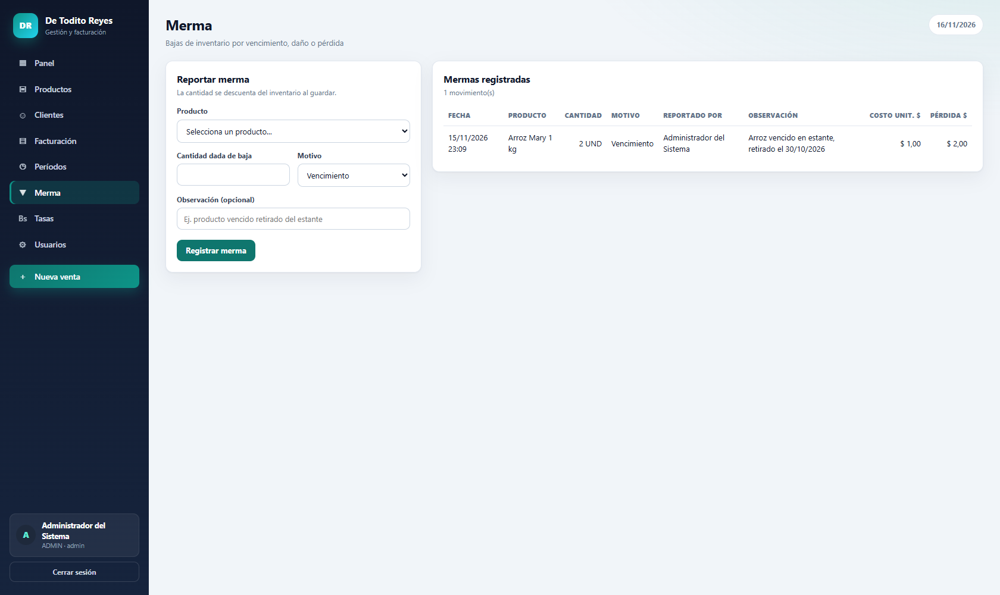

### 12.2 Consultar

La tabla muestra fecha, producto, cantidad, motivo, usuario que reportó y observación. Además, el ADMIN ve **Costo unit. $** y **Pérdida $** (cantidad × costo del momento).

Las mermas también alimentan la tarjeta **Merma** del panel principal: mermas registradas, mermas del mes, pérdida acumulada y pérdida del mes.

### 12.3 Errores frecuentes

| Mensaje | Causa | Solución |
|---|---|---|
| “Selecciona un producto.” | No se eligió producto | Selecciona uno. |
| “La cantidad de merma debe ser mayor que cero.” | Cantidad 0 o negativa | Escribe una cantidad válida. |
| “La cantidad supera el stock disponible...” | Más que el stock | Ajusta la cantidad. |
| “El producto seleccionado no existe o está inactivo.” | Producto desactivado | Reactívalo o elige otro. |

---

## 13. Períodos fiscales (solo ADMIN)

Ruta: **Períodos** (`/periodos`). Es un módulo exclusivo del ADMIN.

Un **período fiscal** es un mes del año. Cerrar un período bloquea la anulación y la eliminación de las facturas emitidas en ese mes. **No bloquea la emisión de facturas nuevas**: el negocio puede seguir vendiendo; lo que se impide es modificar el historial de un mes ya cerrado.

### 13.1 Acceder

1. Entra a **Períodos** desde el menú lateral.
2. Selecciona el **Año** en el desplegable. El sistema muestra los años con facturas, los años con períodos registrados y el año actual.
3. La tabla muestra los 12 meses con:
   - **Facturas:** cantidad de facturas del mes.
   - **Anuladas:** cantidad de facturas anuladas.
   - **Total Bs** y **Total $:** suma de las facturas emitidas (no incluye anuladas).
   - **Estado:** `Abierto` o `Cerrado`, con el usuario y la fecha de cierre.
   - **Acción:** **Cerrar** o **Reabrir**.

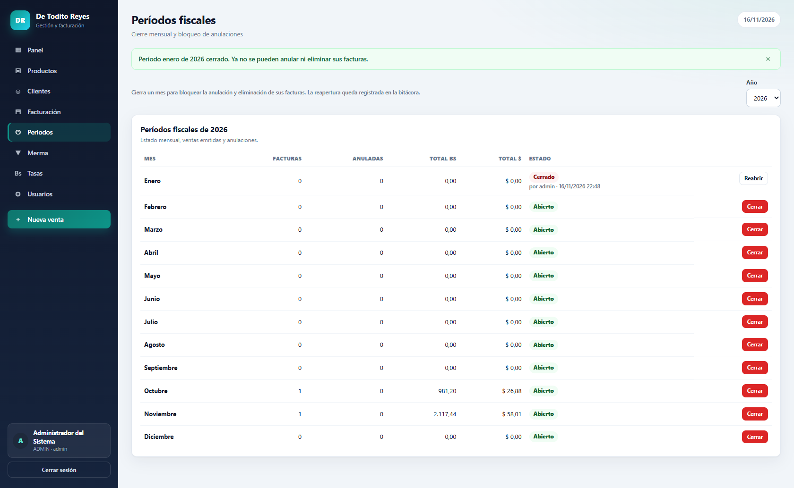

### 13.2 Cerrar un período

1. Ubica el mes que quieres cerrar.
2. Pulsa **Cerrar**.
3. Confirma el aviso: “¿Cerrar este período? No se podrán anular ni eliminar sus facturas hasta reabrirlo.”

El sistema guarda el cierre con la fecha/hora y el usuario que lo ejecutó, y escribe una entrada en la bitácora con la acción `CIERRE`.

Restricciones:

- No se puede cerrar un período **futuro**. El servidor responde “No se puede cerrar un período fiscal futuro.”
- No se puede cerrar dos veces el mismo período. El servidor responde “El período indicado ya está cerrado.”
- El cierre no requiere que el mes tenga facturas; puedes cerrar un mes sin ventas.

### 13.3 Reabrir un período

1. Ubica el mes cerrado (aparece con la etiqueta `Cerrado` y el botón **Reabrir**).
2. Pulsa **Reabrir**.
3. Confirma el aviso: “¿Reabrir este período? Se podrán anular o eliminar facturas otra vez.”

La reapertura queda registrada en la bitácora con la acción `REAPERTURA`. Si el período no estaba cerrado, el servidor responde “El período indicado no está cerrado.”

### 13.4 Efectos sobre las facturas

Mientras un período está cerrado:

- **Anular** una factura de ese mes se rechaza con “El período fiscal de esta factura está cerrado. Un administrador debe reabrirlo antes de anular.”
- **Eliminar** una factura anulada de ese mes se rechaza con “El período fiscal de esta factura está cerrado. Un administrador debe reabrirlo antes de eliminarla.”
- **Emitir** facturas nuevas sigue permitido, incluso en el mes cerrado. La venta se registra con la fecha actual.
- El comprobante, el PDF y el PNG siguen disponibles para consulta y descarga.

### 13.5 Buenas prácticas

- Cierra el mes después de conciliar ventas, anulaciones y mermas.
- Haz una copia de seguridad antes de cerrar el año.
- Reabre solo cuando sea imprescindible y deja constancia del motivo en la bitácora o en un registro interno.
- No cierres un mes que todavía esté en operación si prevés anulaciones o correcciones.

---

## 14. Usuarios (solo ADMIN)

Ruta: **Usuarios** (`/usuarios`).

### 14.1 Crear un usuario

1. En **Nuevo usuario**, completa:
   - **Nombre completo:** obligatorio, máximo 100 caracteres.
   - **Cédula:** obligatoria, formato `V-12345678`; única.
   - **Usuario de acceso:** entre 3 y 40 caracteres; solo minúsculas, números, punto, guion o guion bajo; único.
   - **Rol:** `CAJERO — vende y consulta` o `ADMIN — acceso total`.
   - **Contraseña:** obligatoria al crear; mínimo 6 caracteres, máximo 72.
2. Pulsa **Crear usuario**.

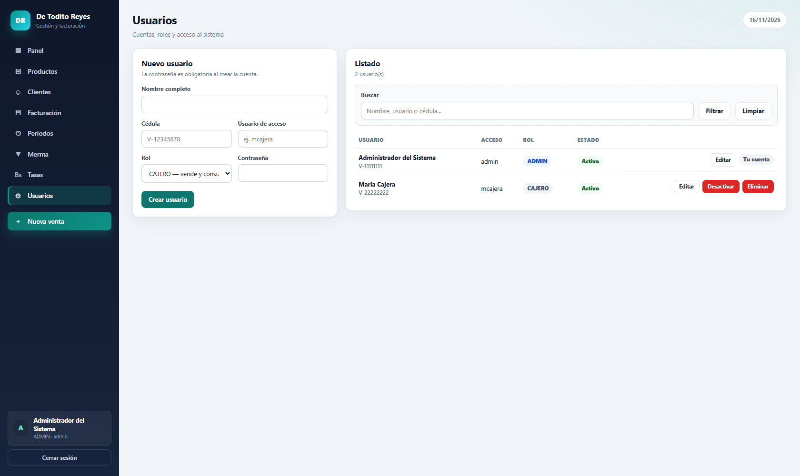

### 14.2 Editar un usuario

1. Pulsa **Editar** en la fila del usuario.
2. Cambia nombre, cédula, usuario o rol.
3. Si quieres cambiar la contraseña, escríbela en **Nueva contraseña (opcional)**. Si la dejas vacía, se conserva la actual.
4. Pulsa **Guardar cambios**.

Si un ADMIN se quita su propio rol, el sistema actualiza la sesión y lo redirige al panel; pierde el acceso a Usuarios.

### 14.3 Restablecer contraseña

Es el mismo formulario de edición: escribe la nueva contraseña y guarda. El usuario deberá usarla en su próximo inicio de sesión.

### 14.4 Activar, desactivar y eliminar

- **Desactivar:** impide el inicio de sesión y cierra la sesión activa en la siguiente petición. No borra el historial. Es la opción recomendada cuando un usuario deja el negocio.
- **Reactivar:** vuelve a permitir el acceso.
- **Eliminar:** solo se permite si el usuario **no tiene facturas, tasas, mermas ni compras**. Si tiene historial, el sistema lo rechaza y sugiere desactivarlo.

### 14.5 Protecciones

- No puedes desactivar ni eliminar tu propia cuenta.
- No se puede dejar el sistema sin al menos un ADMIN activo.
- No se puede repetir cédula ni usuario.
- La contraseña nunca se muestra en el listado.

### 14.6 Buenas prácticas

- Ten al menos dos ADMIN activos.
- Usa cuentas individuales; no compartas el usuario `admin`.
- Desactiva en lugar de eliminar cuando haya historial.
- Cambia la contraseña demo inmediatamente.

---

## 15. Preguntas frecuentes

### ¿Por qué el sistema me pide la contraseña otra vez si ya había entrado?

Porque abriste `/` o `/login` con una sesión activa. El sistema cierra la sesión anterior por seguridad y exige la contraseña de nuevo. También puede ocurrir si pasaron más de 30 minutos de inactividad.

### ¿Por qué no veo Períodos, Merma, Tasas o Usuarios?

Esos módulos son solo para ADMIN. El CAJERO tiene un menú reducido a Mi panel, Productos, Clientes, Facturación y Nueva venta. **Productos** aparece en modo consulta: puede ver precio y stock, pero no costos ni botones de administración.

### ¿Por qué no veo los botones de exportación CSV?

La exportación CSV es exclusiva del ADMIN. El CAJERO puede consultar el historial y abrir sus comprobantes, pero no descargar el CSV completo. Si intenta abrir la URL de exportación, el servidor lo rechaza.

### ¿Por qué solo veo mis facturas en el historial?

Porque el CAJERO tiene un alcance limitado a sus propias ventas. El ADMIN ve las facturas de todos los usuarios. Esta restricción se aplica en el servidor: aunque cambies la URL, no podrás abrir la factura de otro usuario.

### ¿Por qué no puedo anular o eliminar una factura?

Solo el ADMIN puede anular o eliminar. Además:

- Una factura **EMITIDA** debe anularse antes de eliminarse.
- Una factura **ANULADA** se puede eliminar.
- Si el **período fiscal** de la factura está cerrado, primero hay que reabrirlo en **Períodos**.
- La anulación exige un motivo de entre 5 y 200 caracteres.

### ¿Qué es el pago mixto?

Es una venta pagada en parte en divisa (USD) y en parte en bolívares (Bs). El sistema calcula el IGTF solo sobre la porción en divisa, calcula el resto en bolívares y guarda dos pagos separados. El comprobante muestra ambos en el **Desglose de pagos**.

### ¿Por qué el comprobante muestra dos filas de pago?

Porque la factura se pagó con **Mixto**. Una fila es la porción en divisa (USD) y la otra es la porción en bolívares (VES). Las facturas con un solo método muestran una sola fila.

### ¿Por qué el sistema me pidió recargar por un cambio de tasa o de precio?

Porque la tasa BCV o el precio de un producto cambió mientras la venta estaba abierta. El servidor rechaza la emisión para no cobrar un importe distinto al que viste. Recarga el POS, revisa los totales y vuelve a emitir.

### ¿Por qué no se emitió dos veces la misma factura?

Porque el POS usa un **token de emisión** de un solo uso. Un doble clic, un reenvío del navegador o una pestaña vieja no pueden generar dos facturas por la misma venta. Si el token expiró, el sistema avisa y debes abrir **Nueva venta** de nuevo.

### ¿Cómo cierro un mes?

Entra a **Períodos** (solo ADMIN), selecciona el año y pulsa **Cerrar** en el mes correspondiente. El cierre bloquea la anulación y eliminación de las facturas de ese mes, pero no impide seguir vendiendo.

### ¿Puedo vender en un mes cerrado?

Sí. El cierre solo bloquea la anulación y eliminación de facturas de ese mes. Las ventas nuevas se registran con la fecha actual y siguen permitidas.

### ¿Por qué no puedo eliminar un producto?

Porque tiene ventas, compras o mermas asociadas. Para conservar la trazabilidad, desactívalo. Dejará de aparecer en el POS.

### ¿Por qué no puedo eliminar un cliente?

Porque tiene facturas asociadas. Puedes editarlo, pero no borrarlo.

### ¿Por qué no puedo eliminar un usuario?

Porque tiene facturas, tasas, mermas o compras registradas. Desactívalo para bloquear el acceso sin perder el historial.

### ¿Por qué el botón “Descargar imagen” da error?

La extensión GD de PHP no está habilitada. El ADMIN debe habilitar `extension=gd` en `php.ini` y reiniciar Apache. Mientras tanto, usa **Descargar PDF** o **Imprimir**.

### ¿Por qué el PDF no muestra la URL del sistema?

Porque el PDF se genera en el servidor con `PdfFactura`, no con el diálogo “Guardar como PDF” del navegador. El botón **Imprimir** abre ese mismo PDF.

### ¿Por qué la tasa aparece desactualizada?

Porque la fecha de vigencia es anterior a hoy. Un ADMIN debe registrar la tasa del día en **Tasas**. Puedes seguir vendiendo, pero con la tasa anterior.

### ¿Puedo vender sin tasa BCV?

No. El servidor rechaza la emisión si no hay una tasa mayor que cero. El POS muestra un aviso y el botón de emisión no debe usarse hasta que el ADMIN registre la tasa.

### ¿Cómo busco una factura por su código de verificación?

En **Facturación**, escribe el código en **Buscar**. También puedes buscar por número de factura, control fiscal, cliente o RIF/cédula.

### ¿El CSV se abre mal en Excel?

El archivo usa UTF-8 con BOM, separador `;` y decimales con coma. Debe abrirse directamente en Excel en español. Si tu Excel usa otro separador, importa el archivo como CSV y elige `;`.

### ¿Qué hago si veo “La sesión expiró o la solicitud no es válida” (419)?

Recarga la página, vuelve a iniciar sesión y repite la operación. No envíes el formulario dos veces con una pestaña vieja.

### ¿Qué hago si veo “No se pudo conectar con la base de datos”?

Verifica que MySQL esté iniciado en XAMPP y que la base `de_todito_reyes` exista. Si persiste, contacta al ADMIN.

### ¿Puedo usar el sistema desde el celular?

La interfaz es responsive y el menú se abre con **☰**, pero el POS está pensado para pantallas de escritorio. Para vender desde el celular, verifica que la tabla y el carrito sean cómodos en tu dispositivo.

### ¿Dónde se cambian el nombre, RIF y dirección de la empresa?

En `config/empresa.php`. Esos datos salen en el comprobante, el PDF y el PNG. Solo el ADMIN o el responsable de la instalación debe editarlos.

---

## 16. Glosario

| Término | Significado |
|---|---|
| **ADMIN** | Rol con acceso total: inventario, precios, usuarios, tasas, períodos fiscales, anulación y eliminación. |
| **CAJERO** | Rol operativo: vende, registra clientes y consulta sus propias facturas. No registra mermas ni exporta CSV. |
| **BCV** | Banco Central de Venezuela. La tasa se expresa en bolívares por 1 dólar. |
| **Tasa BCV** | Valor del dólar usado para convertir precios USD a Bs. Se registra manualmente. |
| **IVA** | Impuesto al Valor Agregado. Se calcula por producto según su alícuota. |
| **IGTF** | Impuesto a las Grandes Transacciones Financieras. En el sistema se aplica al 3% sobre la porción pagada en divisa. |
| **POS** | Punto de venta: pantalla de catálogo, carrito y emisión. |
| **SKU / Código** | Código único de barras o QR del producto. |
| **Merma** | Salida de inventario por vencimiento, daño, pérdida, robo o ajuste. Solo la registra el ADMIN. |
| **Consecutivo** | Número fiscal de la factura, de 6 dígitos (`000001`). |
| **Control fiscal** | Número de control de la factura (`00-000001`). |
| **Código de verificación** | Código aleatorio de 8 caracteres que acompaña la factura. |
| **Comprobante** | Vista imprimible de la factura con sus datos fiscales y el desglose de pagos. |
| **Anular** | Marcar una factura como `ANULADA`, devolver el stock y registrar el motivo. No se puede revertir. |
| **Eliminar** | Borrar una factura anulada y sus líneas. Solo ADMIN y solo si el período está abierto. |
| **Período fiscal** | Mes del año usado para agrupar facturas. Puede estar abierto o cerrado. |
| **Cierre de período** | Bloqueo de anulación y eliminación de las facturas de un mes. No impide vender. |
| **Reapertura** | Acción de volver a abrir un período cerrado; queda registrada en la bitácora. |
| **Pago mixto** | Venta pagada en parte en divisa (USD) y en parte en bolívares (Bs). |
| **Desglose de pagos** | Tabla del comprobante que muestra método, moneda, monto y equivalente en Bs. |
| **Token de emisión** | Código de un solo uso que evita emitir dos veces la misma venta. |
| **Stock mínimo** | Cantidad a partir de la cual el sistema marca stock bajo. |
| **Stock máximo** | Cantidad objetivo opcional; no bloquea ventas. |
| **Flash** | Mensaje temporal de éxito, aviso o error que se muestra una vez. |
| **CSRF** | Protección contra envíos de formularios desde otro sitio. |
| **Sesión** | Periodo autenticado; expira a los 30 minutos de inactividad. |

---

## 17. Referencia rápida de URLs

| Acción | URL | Rol |
|---|---|---|
| Iniciar sesión | `/` o `/login` | Todos |
| Panel | `/panel` | Todos |
| Cerrar sesión | `/logout` (POST) | Todos |
| Productos | `/productos` | ADMIN y CAJERO (consulta) |
| Clientes | `/clientes` | Todos |
| Facturación / historial | `/facturacion` | Todos (el CAJERO ve solo lo propio) |
| Nueva venta (POS) | `/facturacion/nueva` | Todos |
| Comprobante | `/facturacion/ver/ID` | Todos (el CAJERO solo los propios) |
| Descargar PDF | `/facturacion/pdf/ID` | Todos (el CAJERO solo los propios) |
| Abrir PDF para imprimir | `/facturacion/pdf/ID?ver=1` | Todos (el CAJERO solo los propios) |
| Descargar PNG | `/facturacion/imagen/ID` | Todos (el CAJERO solo los propios) |
| Exportar resumen CSV | `/facturacion/exportar?tipo=resumen` | Solo ADMIN |
| Exportar detalle CSV | `/facturacion/exportar?tipo=detalle` | Solo ADMIN |
| Mermas | `/mermas` | Solo ADMIN |
| Períodos fiscales | `/periodos` | Solo ADMIN |
| Períodos de un año | `/periodos?anio=2026` | Solo ADMIN |
| Tasas BCV | `/tasas` | ADMIN; CAJERO solo lectura por URL |
| Usuarios | `/usuarios` | Solo ADMIN |

Los filtros del historial se pueden combinar:

```text
/facturacion?desde=2026-11-01&hasta=2026-11-30&estado=EMITIDA&q=texto
```

Las URLs antiguas con `.php` (por ejemplo `productos.php` o `periodos.php`) se redirigen a la ruta limpia equivalente.

---

## 18. Buenas prácticas de operación

1. **Cambia las contraseñas demo** antes de la primera venta.
2. **Registra la tasa BCV al inicio del día** y avisa al equipo si cambia.
3. **No compartas usuarios.** Cada cajero debe tener su propia cuenta para que la factura y la bitácora registren al actor correcto.
4. **Revisa el stock bajo** antes de abrir caja.
5. **Usa mermas** para bajas justificadas; no edites el stock a mano para “cuadrar”.
6. **Anula con criterio.** Una anulación devuelve stock, exige motivo y no se puede revertir.
7. **Revisa el desglose de pagos** en ventas mixtas antes de cerrar la factura.
8. **Cierra los períodos después de conciliar.** Un cierre protege el historial, pero también impide corregir anulaciones hasta reabrirlo.
9. **Evita eliminar facturas** salvo que sea estrictamente necesario y con respaldo.
10. **Descarga un respaldo** antes de cambios grandes (productos, usuarios, migraciones o cierre de año).
11. **Cierra sesión** al terminar el turno, especialmente en equipos compartidos.
12. **Reporta errores** con la URL, la hora, el usuario y el mensaje exacto.

---

## 19. Soporte y escalamiento

| Situación | A quién acudir |
|---|---|
| No puedo entrar | ADMIN del sistema |
| Olvidé mi contraseña (CAJERO) | ADMIN |
| Olvidé la contraseña de ADMIN | Responsable técnico con acceso a consola |
| Tasa BCV desactualizada | ADMIN |
| Error al emitir una factura | ADMIN / responsable técnico |
| No puedo anular por período cerrado | ADMIN (reabrir el período) |
| Los pagos mixtos no coinciden | Revisa los montos; si persiste, ADMIN / soporte |
| PNG no descarga | Responsable técnico (habilitar GD) |
| Error de base de datos | Responsable técnico |
| Problema de red o servidor | Responsable de infraestructura |

Para reportar un problema, incluye:

- Usuario y rol.
- Fecha y hora.
- URL o módulo.
- Pasos realizados.
- Mensaje exacto (sin contraseñas).
- Si es posible, una captura de pantalla.

---

*Fin del manual de usuario.*
